<div align="center">


# CapsuleCraft

### Your knowledge base is a folder of emails.

**A local-first note editor and planner with no database, no cloud and no accounts —
every note, task and dataset is a plain, RFC 5322 `.eml` file on your disk.**

[](https://github.com/kostyk348/CapsuleCraft/releases)
[](https://github.com/kostyk348/CapsuleCraft/actions/workflows/ci.yml)
[](native/)
[](LICENSE)
[](#why-eml)
[](#strengths)
[](CONTRIBUTING.md)
[](https://remade.wiki/projects/capsulecraft/)

[English](README.md) · **Русский**

</div>

---

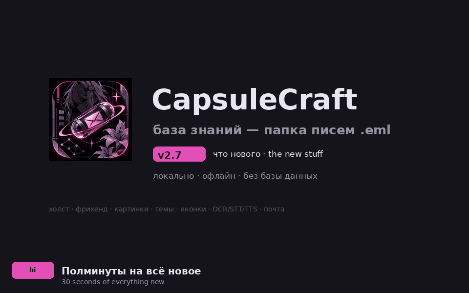

## What is CapsuleCraft?

A desktop app for thinking. Each page is a real email-format file (`.eml` —
RFC 5322 / RFC 2045): open it in Thunderbird, search it with `grep`, diff it in
`git`, back it up with `rsync`, sync it with Syncthing. CapsuleCraft adds the
editor, search, planning and structure on top — and the files stay yours.

- 🗂 **Zero database** — a folder of `.eml` files is the entire knowledge base.
- 🛰 **Offline by design** — parsing, search, AI and planning all run locally; the app makes no network calls of its own.
- 🎨 **Eight full themes** — Graphite, Paper, Nord, Gruvbox, Catppuccin, Solarized, Everforest and Rosé Pine, plus a personal accent colour and an 80–140 % interface scale on top of any of them.
- 🤖 **Offline Co-Thinker** — deterministic local critique and data analysis. No API keys, no cloud.
- 🧩 **Downloadable local AI** — OCR (Xiaomi-OCR-0 on a Rust engine), speech-to-text (whisper) and text-to-speech install from the in-app Integrations catalog and run fully offline.
- 🖥 **Tiny native shell** — Rust + egui, no browser engine. Ships as an AppImage with **zero bundled libraries**.

CapsuleCraft starts **empty** — no demo notes, no filler. A bilingual
**interactive onboarding tour** (auto-opens on first launch, 12 steps, with
"try it" buttons that jump straight into the real feature) and a built-in
**FAQ** (`F1`, `ⓘ FAQ`, or the command palette) explain storage, search and
data transfer right inside the app.

## Screenshots (from the real app)

Every screenshot below is rendered by the app itself — the `--snapshot` CLI
captures the real window with the real fonts, layout and the active theme.

| Page | Search (BM25) |
|---|---|
| 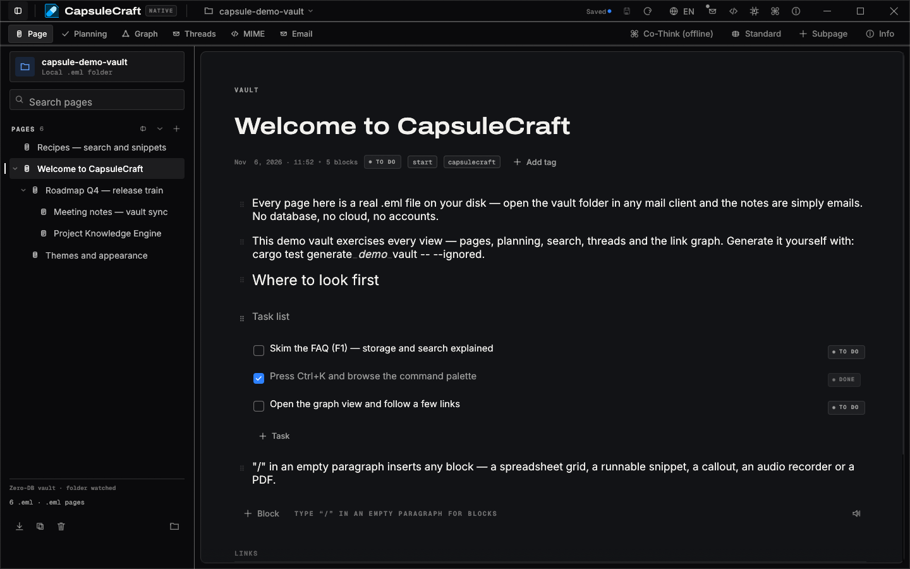 | 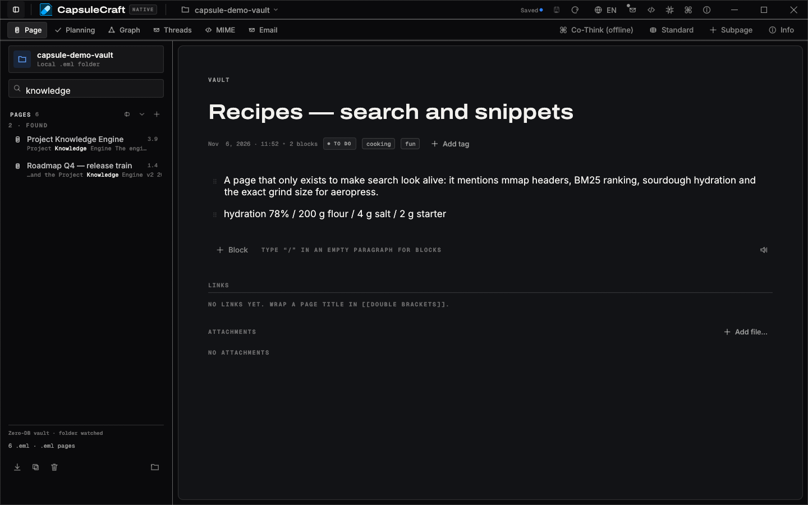 |
| **Planning** | **Graph** |
| 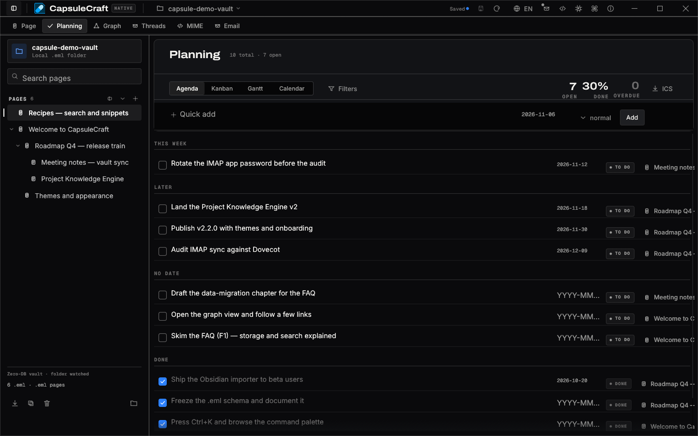 | 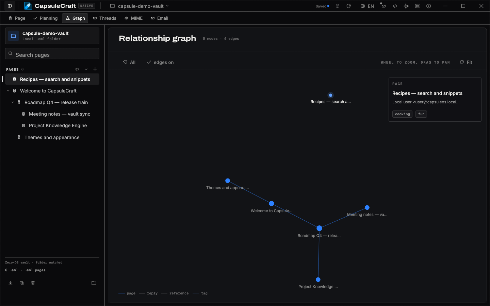 |
| **Onboarding tour (12 steps, RU/EN)** | **FAQ (built-in)** |
| 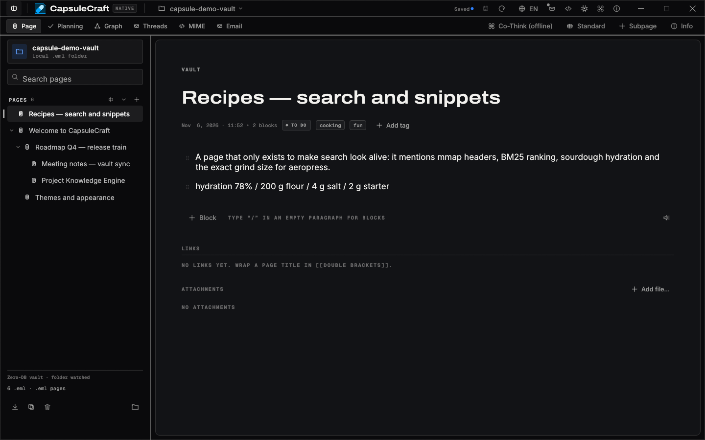 | 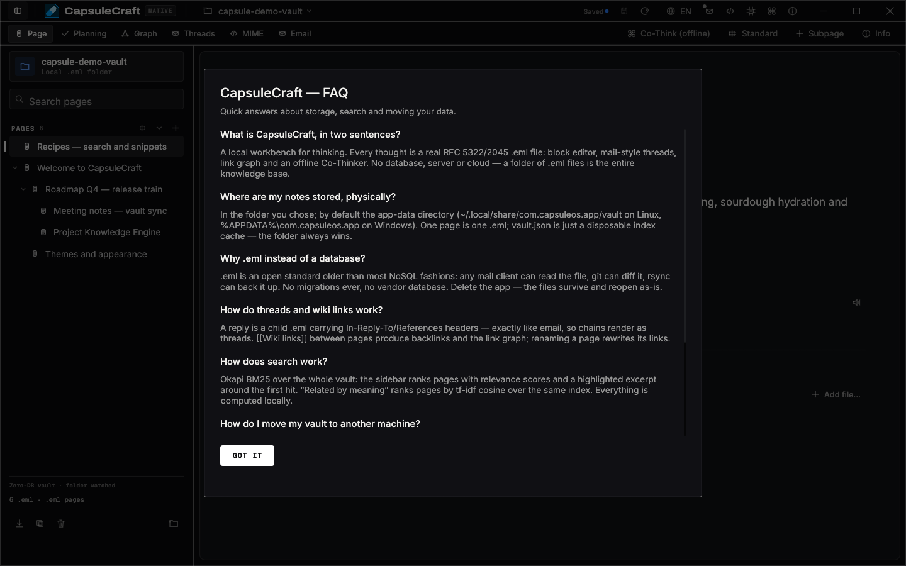 |

<details>
<summary><b>Eight themes</b> — one click each in «Внешний вид / Appearance», plus your own accent colour and interface scale</summary>

| Graphite (default) | Nord |
|---|---|
|  | 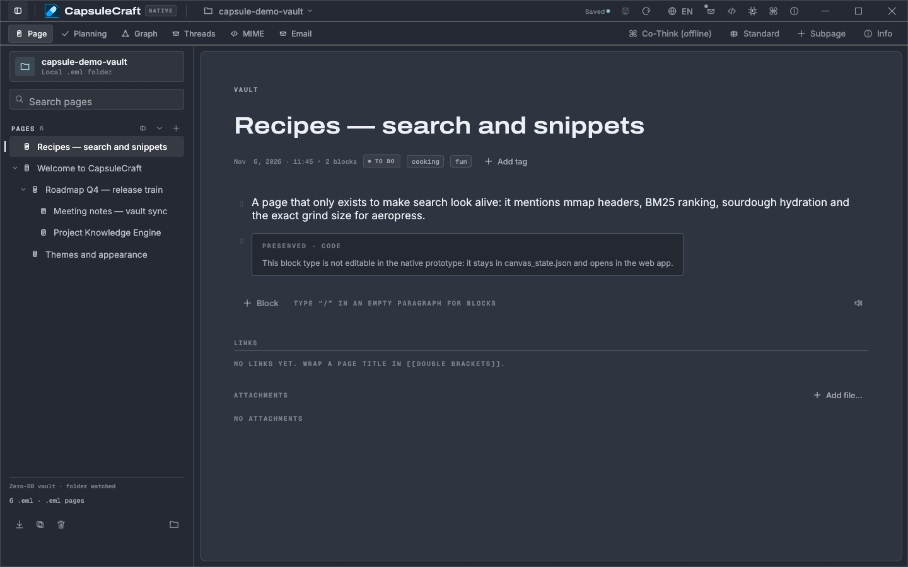 |
| **Gruvbox** | **Catppuccin** |
| 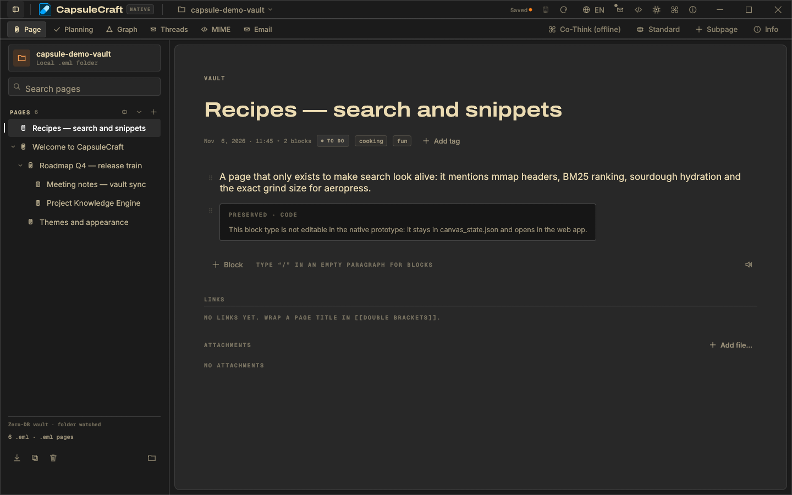 | 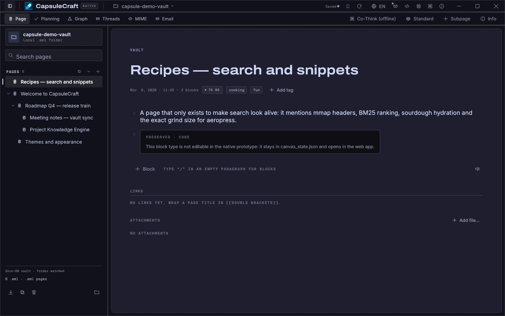 |
| **Paper (light)** | **Rosé Pine** |
| 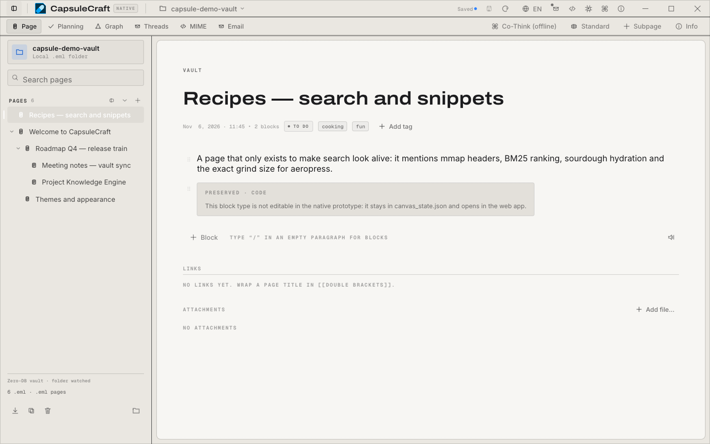 | 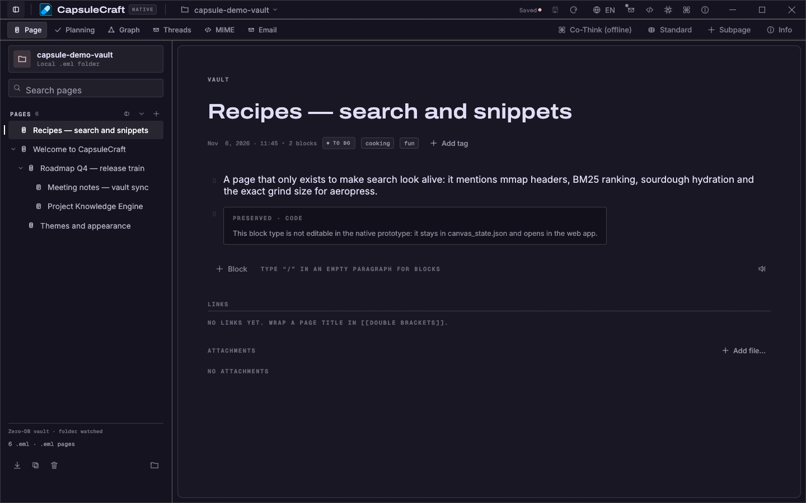 |

Everforest and Solarized ship in the same picker — eight presets total, every
one accepting a custom accent colour and an 80–140 % font scale, all persisted
to a single `native-appearance.json`.

</details>

<details>
<summary><b>More views</b> — threads, raw MIME, mail preview</summary>

| Threads | MIME inspector |
|---|---|
|  |  |
| **Mail view** | |
|  | |

</details>

## Features

- **Block editor** — headings, paragraphs, task lists, callouts, code blocks,
  CSV datagrids, audio-attachment notes; autosave, undo/redo, `.eml` round-trip.
- **`[[Wiki links]]`** — parsed from page text, clickable, with a live backlink
  index («Linked from»); renaming a page rewrites every link.
- **Search** — Okapi BM25 over the whole vault with relevance scores, highlighted
  snippets and Cyrillic-aware case folding; «Related by meaning» ranks pages by
  tf-idf cosine similarity using the same index.
- **Planning** — every task block across the vault aggregated into Agenda,
  Kanban, Gantt (with dependency arrows and cycle protection) and calendar, with
  RFC 5545 ICS export.
- **Theming** — eight complete presets (Graphite, Paper, Nord, Gruvbox,
  Catppuccin, Solarized, Everforest, Rosé Pine) in an Obsidian-style appearance
  picker: theme cards with live swatches, a personal accent colour layered over
  any preset, and an 80–140 % interface scale. Everything persists to
  `native-appearance.json` — copy one file to a new machine and the look follows.
- **Interactive onboarding** — a 12-step bilingual tour opens on first launch
  and stays available from ⌘K («Обзор приложения / Onboarding tour»): it walks
  through every feature and its "try it" buttons open the real thing — the
  command palette, the theme picker, the graph, the integrations catalog.
- **Project Knowledge Engine** — turn a source tree into a knowledge base:
  an incremental scan (FNV-1a + mtime cache, a 500-file rescan in under 30 ms)
  feeds a signature/docstring parser for eight languages (Rust, TypeScript,
  JavaScript, Python, Go, C#, Java, Dart) plus Markdown docs; the result lands
  as `.eml` capsules in `.capsule/` with a tech-debt registry and generated
  agent skills for MCP clients. Orphaned capsules are cleaned automatically
  when a source file is renamed or deleted. The entire engine — parser, cache,
  skills scaffolding and the sidebar folder-folding controls — was contributed
  by [@kobaltgit](https://github.com/kobaltgit) (see
  [docs/PROJECT_KNOWLEDGE_ENGINE.md](docs/PROJECT_KNOWLEDGE_ENGINE.md)).
- **Threads** — replies are real child `.eml`s with `In-Reply-To`/`References`,
  exactly like email. Your reasoning tree is standard mail threading.
- **Datasets** — CSV/JSON travel as MIME parts addressed by `Content-ID`;
  datagrid blocks render them as tables — and `=SUM(A1:A5)`-style formula cells
  are evaluated by the embedded offline JS engine, both in the browser and in
  the native shell.
- **Native audio recording & playback** — record voice notes right from the
  audio block (cpal → 16-bit PCM WAV, live level meter) and play MIME audio
  in the egui shell (rodio: WAV/MP3/OGG/FLAC) with play/pause/stop, scrub
  seeking and a volume slider.
- **OpenPGP capsule encryption** — any capsule can be exported as an armored,
  passphrase-encrypted `.eml.asc` (AES-256, SEIPD v1 via rPGP) and imported
  back with the same dialog; fully offline, no gpg binary required.
- **Offline code execution** — JavaScript REPL blocks run in the native shell
  through the embedded boa engine (the web build uses a sandboxed worker);
  JSON blocks validate and pretty-print; Python/Rust stay honest about having
  no interpreter in a zero-dependency build.
- **Import** — drop `.eml` files into the window (byte-for-byte), import from
  IMAP or migrate an existing Obsidian vault (`--import-obsidian`).
- **AI-agent ready** — expose the vault over [MCP](https://modelcontextprotocol.io)
  so Claude, Cursor or any MCP client can read and search your knowledge base.
  The built-in Co-Thinker argues with your theses offline instead.
- **Built-in FAQ + snapshot CLI** — `--snapshot` renders the real window to PNG
  (which is how every screenshot above was made). RU/EN interface included,
  and the EN locale is enforced 100% Latin by a unit test.

## Why `.eml`?

Most apps lock your knowledge in a database that dies with the app. CapsuleCraft
flips it: one page = one plain-text message on disk.

| | Typical PKM app | CapsuleCraft |
|---|---|---|
| Storage | closed database | plain `.eml` files |
| Opened by | the app only | any mail client, `grep`, `git` |
| Export | lossy conversion | the file is already the export |
| Migrations | App updates | never needed |
| Telemetry / accounts | varies | none — the folder is the app |

## Capsule format

```eml
Message-ID: <capsule-1755000000000@vault.local>
Subject: Q4 pricing experiment
From: Owner <owner@vault.local>
To: Vault <vault@capsuleos.local>
X-Capsule-Tags: pricing, experiment

--capsule-boundary
Content-Type: application/json; name="blocks.json"
Content-ID: <blocks_json>

[{"id":"blk_1","type":"heading","data":{"level":1,"text":"Q4 pricing experiment"}}]
--capsule-boundary
Content-Type: text/csv; name="cohorts.csv"
Content-ID: <dataset_cohorts_csv>

cohort,users,conversion
Q4-A,1200,0.041
--capsule-boundary--
```

The JSON part is the structured block canvas; extra parts are datasets and
attachments addressed by `Content-ID` from datagrid blocks. Threads ride on
standard mail headers.

## How CapsuleCraft compares

| | **CapsuleCraft** | Obsidian | OneNote | Notion |
|---|---|---|---|---|
| Storage format | plain `.eml` (open standard) | Markdown + hidden app data | proprietary binary sections | proprietary cloud database |
| Works fully offline | ✅ by design | ✅ | ⚠️ mostly | ⚠️ limited |
| Account required | ❌ never | ❌ (paid sync needs one) | ✅ Microsoft account | ✅ for sync |
| Your data readable without the app | ✅ Thunderbird / mutt / `grep` | ✅ Markdown | ❌ | ❌ (export only) |
| `git`-diffable, `grep`, `rsync` | ✅ native | ✅ | ❌ | ❌ |
| Real email threading | ✅ `In-Reply-To`/`References` | ❌ | ❌ | ❌ |
| Themes & custom accent | ✅ 8 presets + accent + scale | ✅ (community themes) | ⚠️ dark mode only | ⚠️ limited |
| Local deterministic AI | ✅ Co-Thinker | ⚠️ via plugins/cloud | ⚠️ Copilot (cloud) | ⚠️ cloud |
| Open source | ✅ MIT | ❌ (free but closed) | ❌ | ❌ |
| Install size (Linux) | ~11 MB AppImage, no webview | ~100 MB Electron | 100+ MB | web app |
| Vendor lock-in | none | low | high | high |

**Where Obsidian/OneNote win today:** Obsidian's plugin ecosystem, OneNote's
stylus/inking depth, Notion's collaborative cloud editing. CapsuleCraft is
deliberately narrower: local-first storage you can trust for decades.

## Strengths

- **Data outlives the app.** Delete CapsuleCraft tomorrow — Thunderbird still
  opens every note. No migrations, no conversions, ever.
- **Privacy is structural.** No accounts, no telemetry, no API keys, no network
  calls. The AI runs offline because that's the only honest option.
- **Small and fast.** The native shell has no browser engine inside: an
  8–12 MB AppImage, instant start, glibc-only dependencies.
- **Honest launch.** Starts with an empty vault, a 12-step onboarding tour and
  a built-in FAQ — no demo notes pretending to be data. Known gaps are tracked
  in [LIMITATIONS.md](LIMITATIONS.md), not hidden in marketing.
- **A migration path.** An Obsidian importer, IMAP sync and `.eml` import
  get real content in on day one.

## Getting started

### Download

The **native AppImage** (recommended, Linux) or the **.deb** package:

```bash
chmod +x CapsuleCraft_2.2.0_amd64.AppImage
./CapsuleCraft_2.2.0_amd64.AppImage            # default vault...
./CapsuleCraft_2.2.0_amd64.AppImage /path/to/vault   # ...or your folder
# or the deb:
sudo apt install ./CapsuleCraft_2.2.0_amd64.deb
```

It needs only glibc, an X11 or Wayland desktop and (for audio playback) ALSA —
no WebKitGTK, no WebView2, nothing else. Every GitHub release also carries
`SHA256SUMS.txt`.

The **native Windows installer** (x64) is `CapsuleCraft_2.2.0_x64-setup.exe`
(NSIS: Start-menu & desktop shortcuts, uninstaller). Prefer portable? Use
`CapsuleCraft_native_2.2.0_x64.zip`: unzip it and run `CapsuleCraft.exe`.
Standalone native egui shell, zero dependencies, no WebView2 required.

The **native macOS app** (universal: Apple Silicon + Intel) ships as
`CapsuleCraft_2.2.0_macos_universal.dmg`: open it, drag `CapsuleCraft.app`
onto Applications. It is ad-hoc signed; if Gatekeeper blocks the first launch,
run `xattr -d com.apple.quarantine /Applications/CapsuleCraft.app`.

Releases carry **native builds only** — no web/Tauri installers. The Linux
**AppImage / .deb**, Windows **setup.exe**, and macOS **.dmg** are the app,
period: no browser engine, no webview libraries.

> First launch shows an empty vault, the **onboarding tour** (12 bilingual
> steps — skip it freely, it never nags again and lives in ⌘K) and the
> built-in **FAQ**. Press `F1`, use the `ⓘ FAQ` button or ⌘K → FAQ. No demo
> notes are ever created.

### Build from source

```bash
git clone https://github.com/kostyk348/CapsuleCraft.git
cd CapsuleCraft/native
cargo run --release -- /path/to/your/vault
```

Native-only requirements: Rust stable, no GUI toolkit dependencies.

### Snapshot CLI (docs/CI)

```bash
cargo run --release -- --snapshot out.png --page 1 [--view graph] [--search "query"] [--onboarding]
```

To regenerate the README screenshots: `cargo test generate_demo_vault -- --ignored`
writes a six-page demo vault to `/tmp/capsule-demo-vault`, then run the binary
with `--snapshot` under Xvfb (the exact loop is documented in
`docs/releases/v2.2.0.md`).

## Architecture (native shell)

```text
native/src/
  main.rs        entry, arg parsing, modals wiring, snapshot CLI
  cli.rs         typed CLI surface
  theme.rs       8 theme presets, accent override, font scale, persistence
  mail.rs        RFC 5322 / MIME parsing & serialization
  mime.rs        part splitting, Media-Type registry, datasets
  blocks/        block renderers: paragraph, todo_list, callout, grid, code…
  links.rs       [[wiki links]], backlink index
  graph.rs       capsule relationship DAG
  threads.rs     In-Reply-To / References threading
  planning.rs    agenda / kanban / gantt extraction, ICS export
  search.rs      BM25 index over the whole vault
  project_parser.rs  Project Knowledge Engine (codebase -> .capsule/ vault)
  project_skill.rs   generated agent skills
  mcp.rs         MCP server config for AI agents
  sync_imap.rs   IMAP account sync
  components.rs  integrations catalog (OCR / STT / TTS engines)
  i18n.rs        RU / EN strings
  modals/        onboarding tour, appearance picker, FAQ, MCP, integrations…
  views/         page, graph, mail, mime, planning, threads, palette
```

## Tests

```bash
# native shell
cd native
cargo test          # 230 unit tests

# legacy web engine
npm ci
npx vitest run      # 172 tests
```

## Releases

| Version | What | When |
|---|---|---|
| **v2.2.0** | Obsidian-style theming: 8 complete theme presets, personal accent colour, 80–140 % interface scale, appearance picker in ⌘K; interactive bilingual onboarding tour (12 steps, try-it buttons, first-run auto-open); OCR diagnostics (model preflight + engine log tail in the error); refreshed real-app screenshots incl. a themes gallery | 2026-11-06 |
| **v2.1.0** | PDF pages render again (one pdfium binding per process); image block inserts a picture below any block with width/caption and viewer; OCR fixed (no invalid `-a`, real model id from `/v1/models`, 15-minute cold start, PDF page → OCR); English TTS voice Amy + STT language follows the locale; custom model folders for STT/TTS/OCR | 2026-11-05 |
| **v2.0.0** | Project Knowledge Engine: index any source tree into a `.capsule/` vault of `.eml` pages (incremental FNV-1a scan, signature/docstring parsing for 8 languages, tech-debt registry, zero-loss re-sync) + generated agent skills; folder folding in the sidebar | 2026-11-03 |
| **v1.12.2** | Fixed the ⚙ Integrations button doing nothing (action field lost in `ShellAction::absorb`); Integrations in the ⌘K palette; installers for every platform (Windows NSIS setup.exe, macOS universal .dmg, Linux .deb) | 2026-11-02 |
| **v1.12.1** | Native-only releases (Windows zip, Linux AppImage, macOS universal .app); fixed the Integrations modal swallowing clicks; TTS runtime pinned to the sherpa-onnx tag the FFI mirrors (v1.12.40); component URLs decoupled from release tags | 2026-11-02 |
| **v1.12.0** | Integrations: downloadable local OCR (Xiaomi-OCR-0 on the pure-Rust mistral.rs engine), whisper STT in-process, Russian TTS (piper via sherpa-onnx), native PDF + image viewers | 2026-11-01 |
| **v1.11.0** | Polish: multi-blocker tasks in the web Gantt editor; undo + marquee multi-select on the native whiteboard; seek + volume in native audio playback | 2026-11-01 |
| **v1.10.0** | Microphone recording from the native audio block (cpal → WAV, live meter); fixed audio file attachments never reaching the capsule; AppImage CI fix | 2026-11-01 |
| **v1.9.0** | Roadmap trio in the native shell: audio playback (rodio), OpenPGP `.eml.asc` encryption (rPGP), code execution + grid formulas (boa); full English UI with a purism test | 2026-10-31 |
| **v1.8.1** | Release pipeline rebuilt: native Windows portable build, pre-created release (no more lost artifacts), unified `SHA256SUMS.txt`, native test job in CI | 2026-10-27 |
| **v1.8.0** | Two-tier header, Zen focus mode, wide canvas; macOS arm64 builds; AppImage hardening | 2026-10-26 |
| **v1.7.0** | Built-in FAQ in the shell; no demo notes anywhere; README redrawn | 2026-10-25 |
| **v1.6.0** | Native standalone AppImage (zero bundled libraries) | 2026-10-25 |
| **v1.5.0** | Renamed to CapsuleCraft; native egui shell | 2026-10-23 |
| **v1.4.0** | Planning (Agenda/Kanban/Gantt/ICS); email import | 2026-10-22 |
| **v1.3.0** | Co-Thinker offline proposal engine | 2026-09-25 |
| **v1.2.0** | BM25 search; Linux installers | 2026-09-15 |
| **v1.1.0** | Real audio playback | 2026-09-05 |
| **v1.0.0** | First Tauri release | 2026-08-16 |

## Limitations (honest ones)

See [`LIMITATIONS.md`](LIMITATIONS.md). Notably: audio playback covers
WAV/MP3/OGG/FLAC (browser-recorded webm/opus needs conversion), the JS engine
runs no timed side effects or I/O, and vault sync is still a manual folder copy.

## Roadmap

- ✅ v1.0 – v2.2 (current milestone)
- ✅ Native code execution (REPL / JS table formulas) — done in v1.9.0 (boa)
- ✅ Audio playback in the native shell — done in v1.9.0 (rodio)
- ✅ GPG-encrypted capsules — done in v1.9.0 (rPGP, passphrase `.eml.asc`)
- ✅ macOS native builds in CI (arm64)
- ✅ Full theming (8 presets, accent, font scale) + onboarding tour — done in v2.2.0
- ⬜ Optional end-to-end-encrypted vault sync (tamper/censor-proof, still zero-cloud)

## Contributing

PRs welcome — see [`CONTRIBUTING.md`](CONTRIBUTING.md). Changes are tracked in
[`CHANGELOG.md`](CHANGELOG.md).

## Contributors

- **Konstantin** ([@kostyk348](https://github.com/kostyk348)) — creator, architecture, native shell, theming system, releases
- **kobaltGIT** ([@kobaltgit](https://github.com/kobaltgit)) — author of the **Project Knowledge Engine** (the codebase→knowledge-base pipeline: 8-language signature parser, incremental FNV-1a cache, `.capsule/` capsule generation, tech-debt registry, AI-skills scaffolding, folder folding — the heart of v2.0.0), the in-place rich text editor and block transformation, the two-tier header redesign with Zen focus mode and wide canvas, live vault watching, the offline Co-Thinker, MCP server, Obsidian importer, hierarchy drag & drop, IMAP sync, microphone recording, OpenPGP capsule encryption, grid formulas + code execution, the customizable brand icon, and the multi-platform release pipeline

## License

MIT — see [`LICENSE`](LICENSE).

<div align="center">

**CapsuleCraft** — your thoughts, stored as mail.

</div>
