<div align="center">

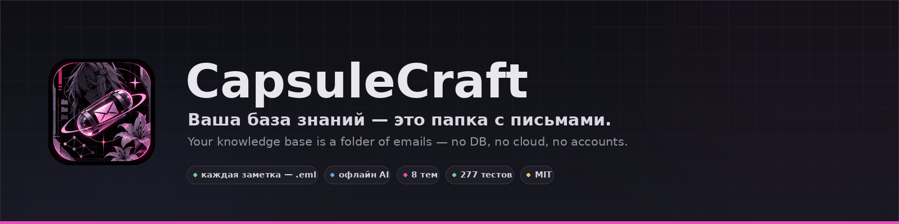

# CapsuleCraft

### Ваша база знаний — это папка с письмами.

**Локальный редактор заметок и планировщик без базы данных, облака и аккаунтов —
каждая заметка, задача и таблица данных это обычный RFC 5322 `.eml`-файл на вашем диске.**

[](https://github.com/kostyk348/CapsuleCraft/releases)
[](https://github.com/kostyk348/CapsuleCraft/actions/workflows/ci.yml)
[](native/)
[](LICENSE)
[](#почему-eml)
[](#сильные-стороны)
[](CONTRIBUTING.md)
[](https://remade.wiki/projects/capsulecraft/)

**Русский** · [English](README.md)

</div>

---

<p align="center">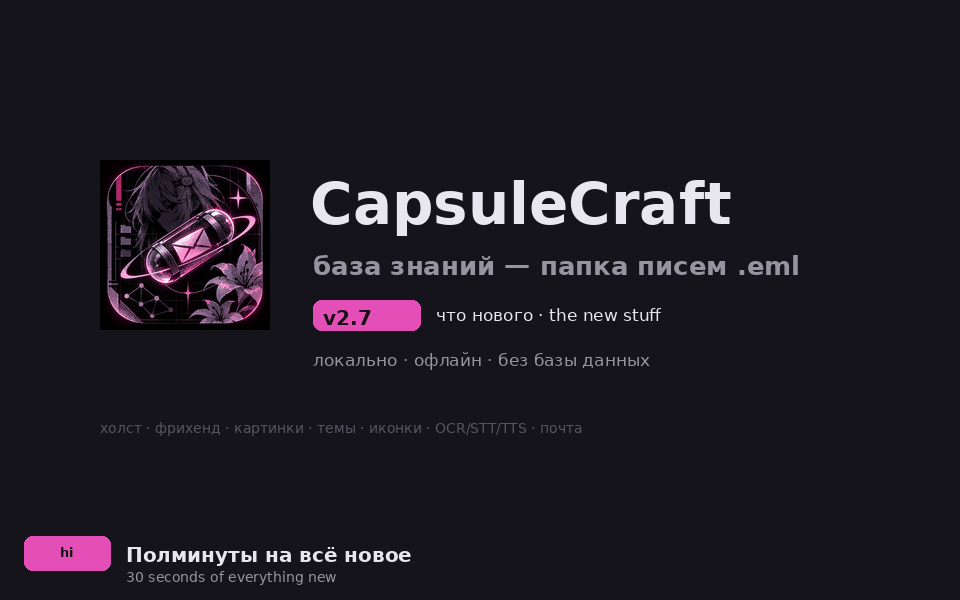</p>

## Что такое CapsuleCraft?

Настольное приложение для мышления. Каждая страница — настоящий файл почтового
формата (`.eml` — RFC 5322 / RFC 2045): откройте его в Thunderbird, найдите
через `grep`, сравните в `git`, забэкапьте через `rsync`, синхронизируйте
Syncthing'ом. CapsuleCraft добавляет сверху редактор, поиск, планирование и
структуру — а файлы остаются вашими.

- 🗂 **Ноль баз данных** — папка с `.eml`-файлами и есть вся база знаний.
- 🛰 **Офлайн по дизайну** — парсинг, поиск, AI и планирование работают локально; приложение само не ходит в сеть.
- 🎨 **Восемь полных тем** — Graphite, Paper, Nord, Gruvbox, Catppuccin, Solarized, Everforest и Rosé Pine, плюс личный акцентный цвет и масштаб интерфейса 80–140 % поверх любой из них.
- 🤖 **Офлайн Co-Thinker** — детерминированная локальная критика и анализ данных. Без API-ключей и облака.
- 🧩 **Скачиваемый локальный AI** — OCR (Xiaomi-OCR-0 на движке на Rust), распознавание речи (whisper) и синтез речи ставятся из каталога «Интеграции» и работают полностью офлайн.
- 🖥 **Крошечный нативный шелл** — Rust + egui, без браузерного движка. Ставится как AppImage **без единой бандл-библиотеки**.

CapsuleCraft стартует **пустым** — ни демо-заметок, ни наполнителя. Двуязычный
**интерактивный тур онбординга** (открывается сам при первом запуске, 12 шагов,
с кнопками «попробовать», ведущими прямо в живую функцию) и встроенный **FAQ**
(`F1`, `ⓘ FAQ` или палитра команд) объясняют хранение, поиск и перенос данных
прямо внутри приложения.

## Скриншоты (из настоящего приложения)

Каждый скриншот ниже отрисован самим приложением — CLI `--snapshot` снимает
настоящее окно с настоящими шрифтами, раскладкой и активной темой.

| Страница | Поиск (BM25) |
|---|---|
| 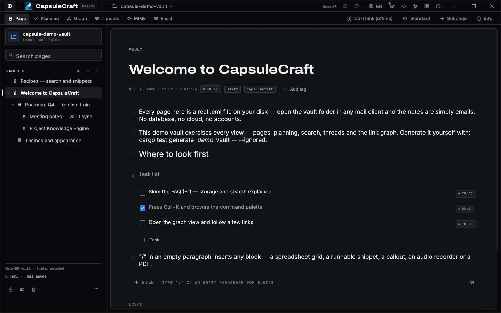 | 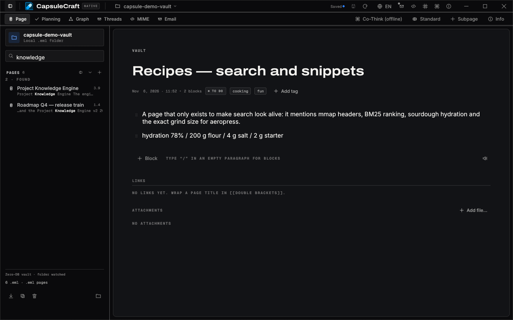 |
| **Планирование** | **Граф** |
| 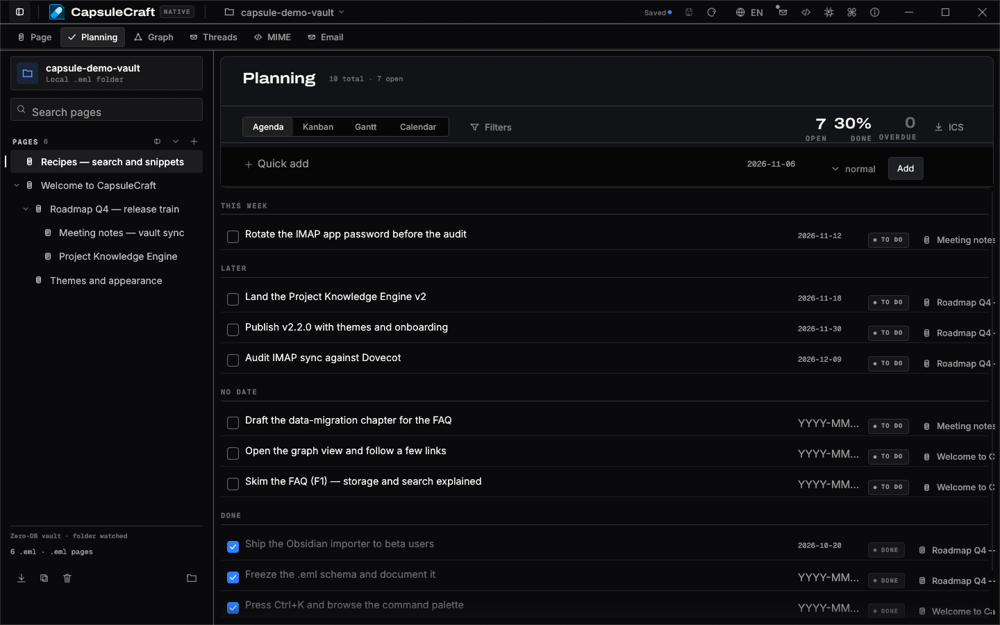 | 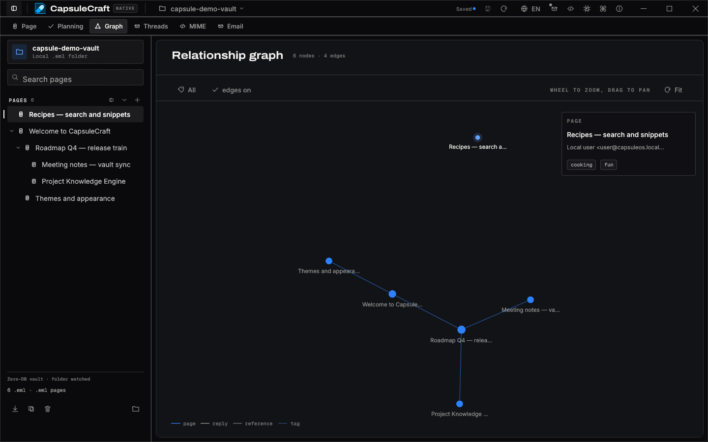 |
| **Тур онбординга (12 шагов, RU/EN)** | **FAQ (встроенный)** |
| 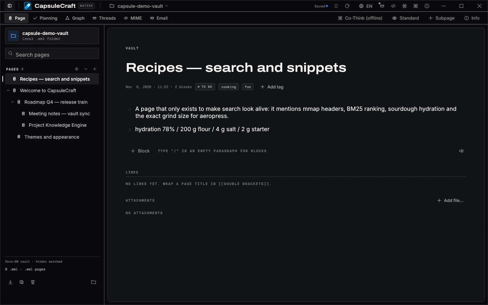 | 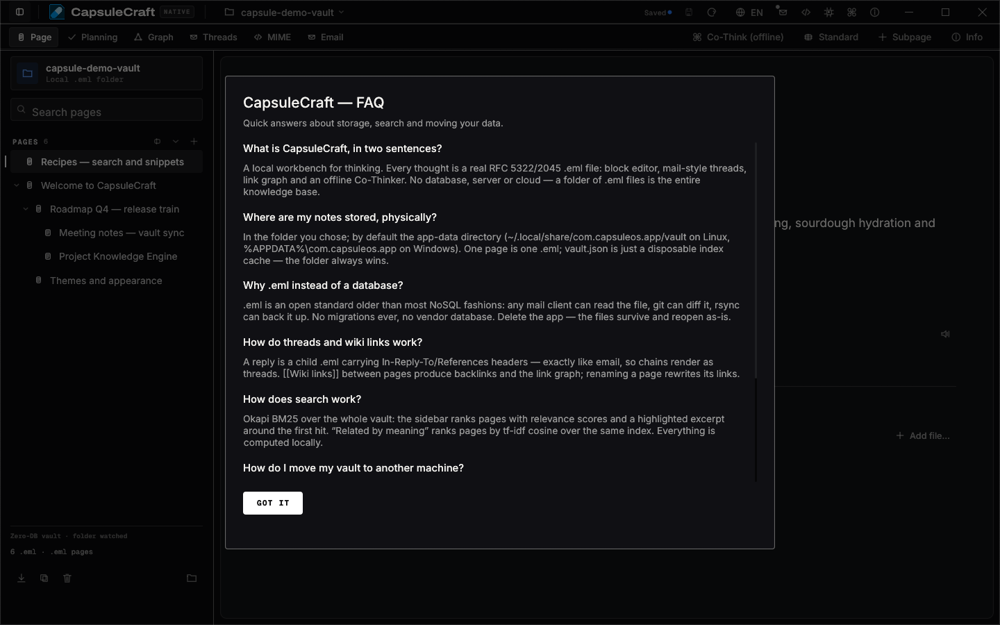 |

<details>
<summary><b>Восемь тем</b> — каждая в один клик в «Внешний вид / Appearance», плюс свой акцент и масштаб интерфейса</summary>

| Graphite (по умолчанию) | Nord |
|---|---|
|  | 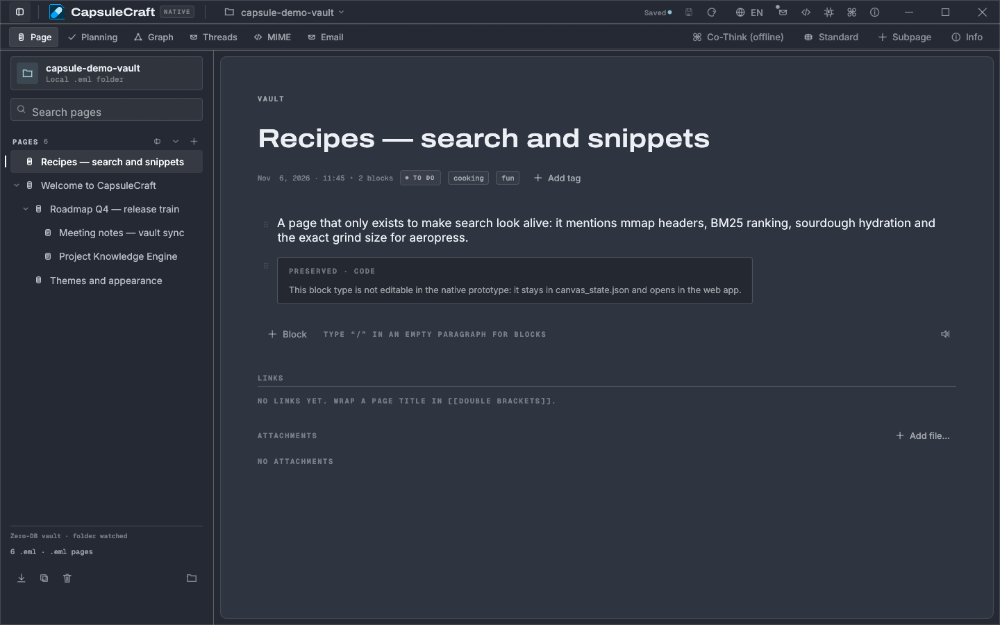 |
| **Gruvbox** | **Catppuccin** |
| 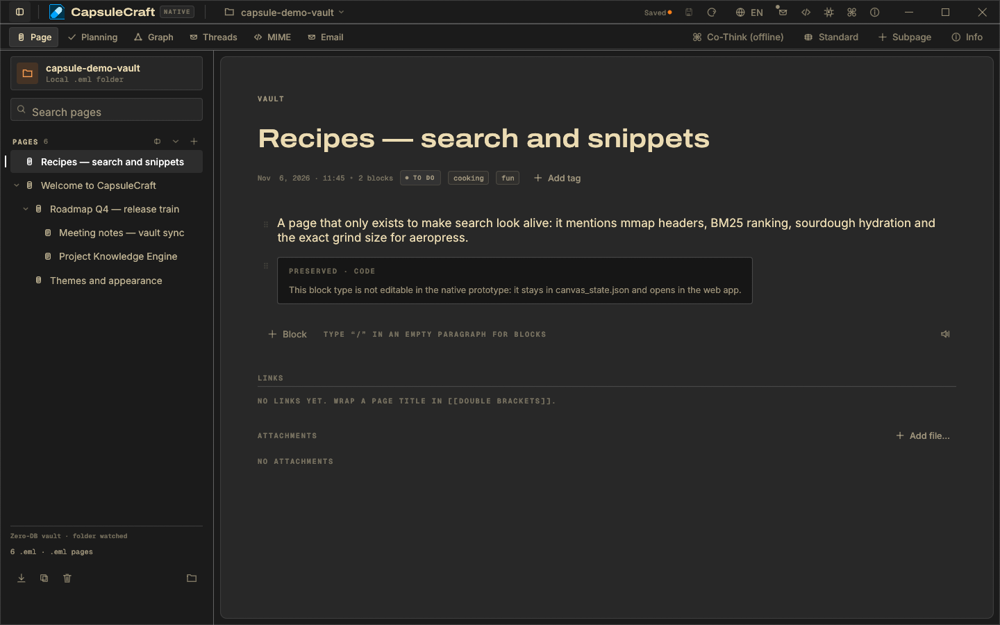 | 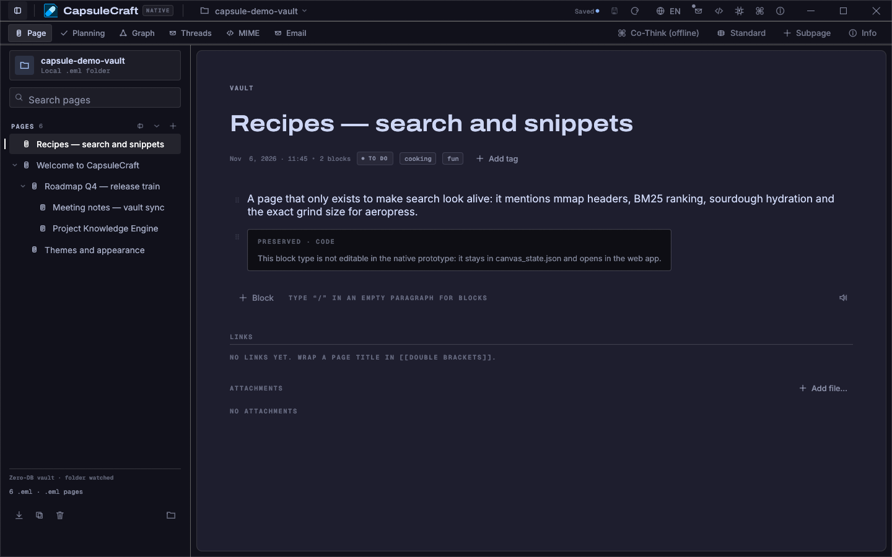 |
| **Paper (светлая)** | **Rosé Pine** |
| 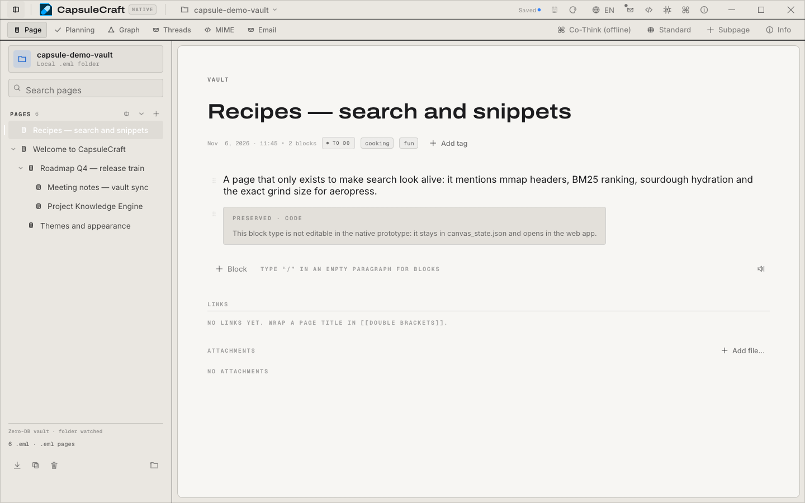 | 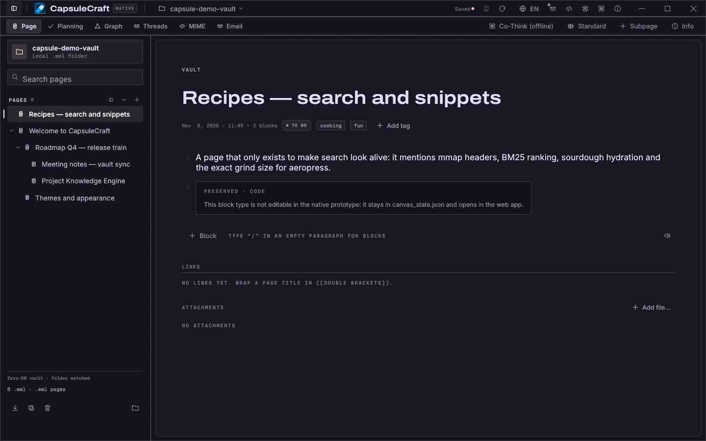 |

Everforest и Solarized лежат в том же пикере — восемь пресетов, каждый принимает
свой акцентный цвет и масштаб шрифта 80–140 %, всё сохраняется в один
`native-appearance.json`.

</details>

<details>
<summary><b>Ещё виды</b> — треды, сырой MIME, почтовый просмотр</summary>

| Треды | MIME-инспектор |
|---|---|
|  |  |
| **Почтовый вид** | |
|  | |

</details>

## Возможности

- **Блочный редактор** — заголовки, абзацы, списки задач, коллауты, блоки кода,
  CSV-датагриды, заметки с аудио-вложениями; автосохранение, undo/redo,
  круговой путь `.eml` без потерь.
- **`[[Вики-ссылки]]`** — парсятся из текста страницы, кликабельны, с живым
  индексом обратных ссылок («Откуда ссылаются»); переименование страницы
  переписывает каждую ссылку.
- **Поиск** — Okapi BM25 по всему хранилищу с оценками релевантности,
  подсветкой сниппетов и регистронезависимостью с учётом кириллицы; «Похожие по
  смыслу» ранжирует страницы по tf-idf косинусной близости по тому же индексу.
- **Планирование** — все задачные блоки хранилища собираются в Повестку,
  Канбан, Гантт (стрелки зависимостей и защита от циклов) и двухпанельный
  календарь: любой план открывает свою страницу кликом — по строке, чипу или
  полосе Ганта — а чип, перетащенный на другой день, переносит срок. Экспорт
  в RFC 5545 ICS.
- **Темы** — восемь полных пресетов (Graphite, Paper, Nord, Gruvbox, Catppuccin,
  Solarized, Everforest, Rosé Pine) в пикере в стиле Obsidian: карточки тем с
  живыми свотчами, личный акцент поверх любого пресета и масштаб интерфейса
  80–140 %. Всё сохраняется в `native-appearance.json` — скопируйте один файл на
  новую машину, и оформление переедет с ним.
- **Интерактивный онбординг** — двуязычный тур из 12 шагов открывается при
  первом запуске и остаётся доступным из ⌘K («Обзор приложения / Onboarding
  tour»): он проходит по каждой функции, а кнопки «попробовать» открывают
  настоящее — палитру команд, пикер тем, граф, каталог интеграций.
- **Project Knowledge Engine** — превратите дерево исходников в базу знаний:
  инкрементальный скан (FNV-1a + кэш по mtime, перескан 500 файлов быстрее
  30 мс) питает парсер сигнатур/докстрингов для восьми языков (Rust,
  TypeScript, JavaScript, Python, Go, C#, Java, Dart) плюс Markdown-доки;
  результат ложится `.eml`-капсулами в `.capsule/` с реестром техдолга и
  сгенерированными агентскими скиллами для MCP-клиентов. Осиротевшие капсулы
  чистятся автоматически при переименовании или удалении исходника. Весь
  движок — парсер, кэш, скиллы и складывание папок в сайдбаре — принёс
  [@kobaltgit](https://github.com/kobaltgit) (см.
  [docs/PROJECT_KNOWLEDGE_ENGINE.md](docs/PROJECT_KNOWLEDGE_ENGINE.md)).
- **Треды** — ответы это настоящие дочерние `.eml` с `In-Reply-To`/`References`,
  ровно как в почте. Ваше дерево рассуждений — стандартный почтовый трединг.
- **Датасеты** — CSV/JSON ездят MIME-частями, адресуемыми по `Content-ID`;
  блоки-датагриды рисуют их таблицами — а формульные ячейки вида
  `=SUM(A1:A5)` считает встроенный офлайн JS-движок boa прямо в нативном
  шелле.
- **Нативная запись и воспроизведение звука** — записывайте голосовые заметки
  прямо из аудио-блока (cpal → 16-бит PCM WAV, живой индикатор уровня) и
  слушайте MIME-аудио в egui-шелле (rodio: WAV/MP3/OGG/FLAC) с
  play/pause/stop, скрабом и громкостью.
- **Шифрование капсул OpenPGP** — любую капсулу можно экспортировать как
  бронированный `.eml.asc` с шифрованием по парольной фразе (AES-256, SEIPD v1
  через rPGP) и импортировать обратно тем же диалогом; полностью офлайн, без
  бинаря gpg.
- **Офлайн-исполнение кода** — REPL-блоки JavaScript работают в нативном шелле
  через встроенный boa; JSON-блоки валидируются
  и красиво печатаются; Python/Rust честно сообщают, что интерпретатора в
  zero-dependency-сборке нет.
- **Импорт** — бросайте `.eml`-файлы в окно (байт-в-байт), импортируйте с IMAP
  или мигрируйте существующее хранилище Obsidian (`--import-obsidian`).
- **Готов к AI-агентам** — выставите хранилище по
  [MCP](https://modelcontextprotocol.io), и Claude, Cursor или любой MCP-клиент
  сможет читать и искать вашу базу знаний. Встроенный Co-Thinker вместо этого
  спорит с вашими тезисами офлайн.
- **Встроенный FAQ + snapshot CLI** — `--snapshot` рендерит настоящее окно в PNG
  (именно так сделан каждый скриншот выше). Интерфейс RU/EN, а английская
  локаль на 100 % латиница — под защитой юнит-теста.

## Почему `.eml`?

Большинство приложений запирают знания в базе данных, которая умирает вместе с
приложением. CapsuleCraft переворачивает это: одна страница = один текстовый
файл на диске.

| | Типичное PKM-приложение | CapsuleCraft |
|---|---|---|
| Хранение | закрытая база | обычные `.eml`-файлы |
| Чем открыть | только само приложение | любой почтовый клиент, `grep`, `git` |
| Экспорт | конвертация с потерями | файл и есть экспорт |
| Миграции | обновления приложения | не нужны никогда |
| Телеметрия / аккаунты | как повезёт | нет — папка и есть приложение |

## Формат капсулы

```eml
Message-ID: <capsule-1755000000000@vault.local>
Subject: Q4 pricing experiment
From: Owner <owner@vault.local>
To: Vault <vault@capsuleos.local>
X-Capsule-Tags: pricing, experiment

--capsule-boundary
Content-Type: application/json; name="blocks.json"
Content-ID: <blocks_json>

[{"id":"blk_1","type":"heading","data":{"level":1,"text":"Q4 pricing experiment"}}]
--capsule-boundary
Content-Type: text/csv; name="cohorts.csv"
Content-ID: <dataset_cohorts_csv>

cohort,users,conversion
Q4-A,1200,0.041
--capsule-boundary--
```

JSON-часть — структурированный блочный холст; остальные части это датасеты и
вложения, адресуемые по `Content-ID` из блоков-датагридов. Треды ездят на
стандартных почтовых заголовках.

## Как CapsuleCraft сравнивается

| | **CapsuleCraft** | Obsidian | OneNote | Notion |
|---|---|---|---|---|
| Формат хранения | обычный `.eml` (открытый стандарт) | Markdown + скрытые данные приложения | проприетарные бинарные секции | проприетарная облачная база |
| Полностью офлайн | ✅ по дизайну | ✅ | ⚠️ в основном | ⚠️ ограниченно |
| Нужен аккаунт | ❌ никогда | ❌ (платная синхронизация требует) | ✅ аккаунт Microsoft | ✅ для синхронизации |
| Данные читаются без приложения | ✅ Thunderbird / mutt / `grep` | ✅ Markdown | ❌ | ❌ (только экспорт) |
| `git`-диффы, `grep`, `rsync` | ✅ нативно | ✅ | ❌ | ❌ |
| Настоящий почтовый трединг | ✅ `In-Reply-To`/`References` | ❌ | ❌ | ❌ |
| Темы и свой акцент | ✅ 8 пресетов + акцент + масштаб | ✅ (комьюнити-темы) | ⚠️ только тёмный режим | ⚠️ ограниченно |
| Локальный детерминированный AI | ✅ Co-Thinker | ⚠️ плагины/облако | ⚠️ Copilot (облако) | ⚠️ облако |
| Открытый код | ✅ MIT | ❌ (бесплатно, но закрыто) | ❌ | ❌ |
| Размер установки (Linux) | ~11 МБ AppImage, без вебвью | ~100 МБ Electron | 100+ МБ | веб-приложение |
| Vendor lock-in | нет | низкий | высокий | высокий |

**Где Obsidian/OneNote выигрывают сегодня:** экосистема плагинов Obsidian,
глубина стилуса/инкинга OneNote, совместное облачное редактирование Notion.
CapsuleCraft сознательно уже: локальное хранение, которому можно верить десятилетиями.

## Сильные стороны

- **Данные переживут приложение.** Удалите CapsuleCraft завтра — Thunderbird
  всё равно откроет каждую заметку. Никаких миграций и конвертаций. Никогда.
- **Приватность структурна.** Ни аккаунтов, ни телеметрии, ни API-ключей,
  ни сетевых вызовов. AI работает офлайн, потому что это единственный честный вариант.
- **Маленький и быстрый.** В нативном шелле нет браузерного движка: AppImage
  на 8–12 МБ, мгновенный старт, зависимости только glibc.
- **Честный запуск.** Стартует с пустым хранилищем, 12-шаговым туром и
  встроенным FAQ — никаких демо-заметок, притворяющихся данными. Известные
  пробелы перечислены в [LIMITATIONS.md](LIMITATIONS.md), а не спрятаны в маркетинге.
- **Есть путь миграции.** Импортёр Obsidian, IMAP-синхронизация и импорт `.eml`
  дадут настоящий контент в первый же день.

## Начало работы

### Скачать

**Нативный AppImage** (рекомендуется, Linux) или **.deb**-пакет:

```bash
chmod +x CapsuleCraft_2.9.0_amd64.AppImage
./CapsuleCraft_2.9.0_amd64.AppImage            # хранилище по умолчанию...
./CapsuleCraft_2.9.0_amd64.AppImage /path/to/vault   # ...или ваша папка
# или deb:
sudo apt install ./CapsuleCraft_2.9.0_amd64.deb
```

Нужны только glibc, десктоп X11 или Wayland и (для звука) ALSA — ни WebKitGTK,
ни WebView2, ничего больше. Каждый GitHub-релиз несёт и `SHA256SUMS.txt`.

**Нативный установщик Windows** (x64) — `CapsuleCraft_2.9.0_x64-setup.exe`
(NSIS: ярлыки в «Пуск» и на рабочем столе, деинсталлятор). Хотите портативно?
Берите `CapsuleCraft_native_2.8.0_x64.zip`: распакуйте и запустите
`CapsuleCraft.exe`. Стandalone-нативный egui-шелл, ноль зависимостей, WebView2
не нужен.

**Нативное приложение macOS** (универсальное: Apple Silicon + Intel) —
`CapsuleCraft_2.9.0_macos_universal.dmg`: откройте, перетащите
`CapsuleCraft.app` в Applications. Подпись ad-hoc; если Gatekeeper заблокирует
первый запуск, выполните `xattr -d com.apple.quarantine /Applications/CapsuleCraft.app`.

Релизы несут **только нативные сборки** — унаследованный веб-движок удалён из
репозитория в v2.9.0, веб/Tauri-установщиков не существует.
Linux **AppImage / .deb**, Windows **setup.exe** и macOS **.dmg** — это и есть
приложение: без браузерного движка и библиотек вебвью.

#### Где живут данные

Компоненты (движки OCR/STT/TTS и модель OCR на 1.75 ГБ), указатель активного
хранилища и недавние хранилища едут в **каталог данных**: `%APPDATA%\com.capsuleos.app`
(Windows), `$XDG_DATA_HOME/com.capsuleos.app` или `~/.local/share/com.capsuleos.app`
(Linux/macOS). Настройки (тема, зум, свои папки моделей) едут в **каталог
конфигурации**: `~/.config/capsuleos` или `$XDG_CONFIG_HOME/capsuleos`. Оба
независимы от того, где лежит AppImage, .deb или портативный бинарь — обновление
никогда не трогает ваши движки и модели. Портативный запуск может перенести оба
каталога:

```bash
CAPSULECRAFT_DATA_DIR=/mnt/usb/capsulecraft-data ./CapsuleCraft_amd64.AppImage
CAPSULECRAFT_CONFIG_DIR=/mnt/usb/capsulecraft-config ./CapsuleCraft_amd64.AppImage
```

> Первый запуск показывает пустое хранилище, **тур онбординга** (12 двуязычных
> шагов — смело пропускайте, он не навязывается и живёт в ⌘K) и встроенный
> **FAQ**. Жмите `F1`, кнопку `ⓘ FAQ` или ⌘K → FAQ. Демо-заметки не создаются никогда.

### Сборка из исходников

```bash
git clone https://github.com/kostyk348/CapsuleCraft.git
cd CapsuleCraft/native
cargo run --release -- /path/to/your/vault
```

Требования только нативные: Rust stable, никаких зависимостей GUI-тулкитов.

### Snapshot CLI (доки/CI)

```bash
cargo run --release -- --snapshot out.png --page 1 [--view graph] [--search "query"] [--onboarding]
```

Чтобы пересоздать скриншоты README: `cargo test generate_demo_vault --
--ignored` пишет демо-хранилище на шесть страниц в `/tmp/capsule-demo-vault`,
затем запустите бинарь с `--snapshot` под Xvfb (точный цикл описан в
`docs/releases/v2.2.0.md`).

## Архитектура (нативный шелл)

```text
native/src/
  main.rs        вход, разбор аргументов, модалки, snapshot CLI
  cli.rs         типизированный CLI
  theme.rs       8 пресетов тем, акцент, масштаб шрифта, персистентность
  mail.rs        парсинг и сериализация RFC 5322 / MIME
  mime.rs        разделение частей, реестр Media-Type, датасеты
  blocks/        рендереры блоков: paragraph, todo_list, callout, grid, code…
  links.rs       [[вики-ссылки]], индекс обратных ссылок
  graph.rs       DAG связей капсул
  threads.rs     трединг по In-Reply-To / References
  planning.rs    повестка / канбан / гантт, экспорт ICS
  search.rs      BM25-индекс по всему хранилищу
  project_parser.rs  Project Knowledge Engine (кодовая база -> .capsule/)
  project_skill.rs   сгенерированные агентские скиллы
  mcp.rs         конфиг MCP-сервера для AI-агентов
  sync_imap.rs   синхронизация IMAP-аккаунтов
  components.rs  каталог интеграций (движки OCR / STT / TTS)
  i18n.rs        строки RU / EN
  modals/        тур онбординга, пикер оформления, FAQ, MCP, интеграции…
  views/         страница, граф, почта, mime, планирование, треды, палитра
```

## Тесты

```bash
# нативный шелл
cd native
cargo test          # 286 юнит-тестов
```

## Релизы

| Версия | Что | Когда |
|---|---|---|
| **v2.9.0** | Блоки двигаются тремя способами (тулбар при наведении ↑/⧉/↓, полноростовая полоса захвата в гуттере, Alt+↑/↓), починен недостижимый верхний гэп драга; канвас открывается на контенте, клавиатурный зум `+`/`−`/`Home`/`Ctrl+0`, миникарта с любого контента; **синхронизация между устройствами** — двустороннее слияние хранилища ↔ папка (LWW по mtime, 5 тестов), кнопка «Синхронизировать» в сайдбаре; начало Android (NativeActivity scaffold, debug-APK в CI, выловлено 5 препятствий кросс-сборки); **унаследованный веб-движок удалён** — в репозитории остался только нативный шелл, CI гоняет только нативные тесты. Тесты 277 → 286 | 2026-11-07 |
| **v2.8.0** | Планирование стало кликабельным, а календарь — удобным: каждый план открывает свою страницу (фон строки, чип в календаре, «+N», полоса Ганта — пять регрессионных тестов гоняют настоящие pointer-события); календарь стал двухпанельным — слева сетка месяца, справа выбранный день с полными строками задач и быстрым добавлением, а чип, **перетащенный на другой день, переносит срок**; восстановлен русский README (`README.ru.md`, переключатель языков теперь честно работает в обоих файлах); промо-баннер и соцкарточка. Тесты 272 → 277 | 2026-11-07 |
| **v2.7.0** | Наборы иконок: **Nova** (новый дефолт), **Document**, **Capsule**, **свой PNG** — живое переключение таскбара/тайтлбара, команды палитры + цикл по маркеру, legacy-алиас `mascot` сохранён; **починен drag-to-reorder блоков** (мёртв с v2.2.1 — устаревшая очистка гонялась с лендингом; регрессионный тест прогоняет настоящий pointer-drag); промо-лента `demo.gif` в README (упоминалась, но не существовала) + хиро Nova + честные счётчики. Тесты 268 → 272 | 2026-11-07 |
| **v2.6.0** | Рисование от руки на канвасе: тумблер «Рисовать» (Icon::Pen), децимированные штрихи как `{type:"ink"}` (bbox + относительные точки), отрисовка полилинией/точкой, персистентный флаг пера; де-рейсинг теста STT busy-флага (красный CI релиза v2.5.0). Тесты 263 → 268 | 2026-11-07 |
| **v2.5.0** | Картинки-ноды на канвасе: «Картинка» в тулбаре берёт из картинок капсулы или файла, нода ссылается на вложение по cid (одна копия байт), отрисовка леттербоксом с тихим плейсхолдером, двойной клик открывает вьюер; страничный режим и блочный канвас делят одну систему ops. Тесты 259 → 263 | 2026-11-07 |
| **v2.4.1** | Добавление из тулбара канваса спавнит элемент в видимый центр (раньше было прибито к мировому началу — улетало за экран после панорамирования: «при добавлении через кнопку нестабильно показывает»), +16 px каскад для подряд идущих добавлений; тесты 255 → 259 | 2026-11-07 |
| **v2.4.0** | Страничный режим «Страница \| Канвас»: каждая страница переключается между блочным редактором и полноэкранным канвасом (движок v2.3: пан/зум, стрелки, фигуры, снап, миникарта); диаграммы сохраняются как `page-canvas.json` внутри того же `.eml`; ноды-ссылки открывают/создают страницы как `[[вики-ссылки]]`; IMAP-синхронизация вынесена с потока UI, дубли-пруф скачивания (хеширование содержимого + имена по Message-Id), работающий auto_sync; честные каталоги данных с переопределениями `CAPSULECRAFT_DATA_DIR` / `CAPSULECRAFT_CONFIG_DIR` | 2026-11-07 |
| **v2.3.0** | Движок канваса: нодовые доски с пан/зумом, прилипанием, миникартой и undo; стикеры, фигуры, стрелки и свободный текст как элементы первого класса; Гантт планирования и доска делят один язык зумируемого поля | 2026-11-07 |
| **v2.2.1** | Обещания редактора выполнены: «Вставить ниже ▸» разворачивает полную палитру блоков в меню грипа; нотионовский «+» появляется в гуттере при наведении и вставляет под наведённый блок; слэш-меню — ввод «/» открывает живую плавающую палитру и конвертирует абзац; drag-and-drop перестановка блоков с акцентной линией вставки (сам op доехал только в v2.7.0); манифесты версий синхронизированы после хвостов 2.1.0 | 2026-11-06 |
| **v2.2.0** | Тематизация в стиле Obsidian: 8 полных пресетов, личный акцент, масштаб интерфейса 80–140 %, пикер оформления в ⌘K; интерактивный двуязычный тур онбординга (12 шагов, кнопки «попробовать», автозапуск на первом старте); диагностика OCR (префлайт модели + хвост лога движка в ошибке); обновлённые скриншоты из настоящего приложения, включая галерею тем | 2026-11-06 |
| **v2.1.0** | PDF-страницы снова рендерятся (один биндинг pdfium на процесс); блок «картинка» вставляет изображение под любым блоком с шириной/подписью и вьюером; OCR починен (нет невалидного `-a`, настоящий id модели из `/v1/models`, 15-минутный холодный старт, страница PDF → OCR); английский голос TTS Amy + язык STT следует локали; свои папки моделей для STT/TTS/OCR | 2026-11-05 |
| **v2.0.0** | Project Knowledge Engine: индексируйте любое дерево исходников в `.capsule/`-хранилище из `.eml`-страниц (инкрементальный скан FNV-1a, парсер сигнатур/докстрингов для 8 языков, реестр техдолга, рескан без потерь) + сгенерированные агентские скиллы; складывание папок в сайдбаре | 2026-11-03 |
| **v1.12.2** | Починена кнопка ⚙ «Интеграции», которая ничего не делала (поле action терялось в `ShellAction::absorb`); Интеграции в палитре ⌘K; установщики для всех платформ (Windows NSIS setup.exe, macOS universal .dmg, Linux .deb) | 2026-11-02 |
| **v1.12.1** | Только-нативные релизы (Windows zip, Linux AppImage, macOS universal .app); починена модалка «Интеграции», глотавшая клики; TTS-рантайм прибит к тегу sherpa-onnx, который зеркалит FFI (v1.12.40); URL компонентов отвязаны от тегов релизов | 2026-11-02 |
| **v1.12.0** | Интеграции: скачиваемый локальный OCR (Xiaomi-OCR-0 на чисто-растовском движке mistral.rs), whisper STT в процессе, русский TTS (piper через sherpa-onnx), нативные просмотрщики PDF и картинок | 2026-11-01 |
| **v1.11.0** | Полировка: мультиблокерные задачи в веб-редакторе Ганта; undo + marquee мультивыделение на нативной вайтборде; seek + громкость в нативном аудио | 2026-11-01 |
| **v1.10.0** | Запись с микрофона из нативного аудио-блока (cpal → WAV, живой индикатор); починены аудио-вложения, не доходившие до капсулы; фиксы CI AppImage | 2026-11-01 |
| **v1.9.0** | Трио роадмапа в нативном шелле: воспроизведение аудио (rodio), шифрование OpenPGP (rPGP), исполнение кода + формулы грида (boa); полный английский интерфейс с тестом на чистоту | 2026-10-31 |
| **v1.8.1** | Пайплайн релизов перестроен: портативная сборка Windows, предсозданный релиз (артефакты больше не теряются), единый `SHA256SUMS.txt`, нативная тестовая джоба в CI | 2026-10-27 |
| **v1.8.0** | Двухъярусный хедер, режим фокуса Zen, широкий канвас; сборки macOS arm64; укрепление AppImage | 2026-10-26 |
| **v1.7.0** | Встроенный FAQ в шелле; никаких демо-заметок; перерисованный README | 2026-10-25 |
| **v1.6.0** | Standalone-нативный AppImage (ноль бандл-библиотек) | 2026-10-25 |
| **v1.5.0** | Переименование в CapsuleCraft; нативный egui-шелл | 2026-10-23 |
| **v1.4.0** | Планирование (Повестка/Канбан/Гантт/ICS); импорт почты | 2026-10-22 |
| **v1.3.0** | Офлайн-движок предложений Co-Thinker | 2026-09-25 |
| **v1.2.0** | Поиск BM25; установщики Linux | 2026-09-15 |
| **v1.1.0** | Настоящее воспроизведение аудио | 2026-09-05 |
| **v1.0.0** | Первый релиз на Tauri | 2026-08-16 |

## Ограничения (честные)

См. [`LIMITATIONS.md`](LIMITATIONS.md). Главное: воспроизведение аудио
покрывает WAV/MP3/OGG/FLAC (записанный в браузере webm/opus требует
конвертации), JS-движок не исполняет таймеры и I/O, а синхронизация —
двустороннее слияние папок без встроенного облачного транспорта.

## Дорожная карта

- ✅ v1.0 – v2.2 (текущий майлстоун)
- ✅ Нативное исполнение кода (REPL / табличные формулы JS) — готово в v1.9.0 (boa)
- ✅ Аудио в нативном шелле — готово в v1.9.0 (rodio)
- ✅ GPG-шифрование капсул — готово в v1.9.0 (rPGP, `.eml.asc` с парольной фразой)
- ✅ Нативные сборки macOS в CI (arm64)
- ✅ Полная тематизация (8 пресетов, акцент, масштаб) + тур онбординга — готово в v2.2.0
- ⬜ Опциональная end-to-end-шифрованная синхронизация хранилища (устойчивая к подделке и цензуре, по-прежнему ноль облака)

## Сообщество

- 🐛 **Issues** — баги и запросы фич: [github.com/kostyk348/CapsuleCraft/issues](https://github.com/kostyk348/CapsuleCraft/issues)
- 🚀 **Релизы** — установщики для Windows, macOS и Linux с `SHA256SUMS.txt` к каждой сборке: [github.com/kostyk348/CapsuleCraft/releases](https://github.com/kostyk348/CapsuleCraft/releases)
- 💬 **Discussions** — пока не включены; откройте issue, и его направят куда надо.
- ✉️ **Telegram / X** — официального канала пока нет; если зеркалируете релизы, откройте issue — ссылка появится здесь.

## Участие

PR приветствуются — см. [`CONTRIBUTING.md`](CONTRIBUTING.md). Изменения
отслеживаются в [`CHANGELOG.md`](CHANGELOG.md).

## Контрибьюторы

- **Константин** ([@kostyk348](https://github.com/kostyk348)) — автор, архитектура, нативный шелл, система тем, релизы
- **kobaltGIT** ([@kobaltgit](https://github.com/kobaltgit)) — автор **Project Knowledge Engine** (конвейер кодовая база → база знаний: парсер сигнатур для 8 языков, инкрементальный кэш FNV-1a, генерация `.capsule/`-капсул, реестр техдолга, агентские скиллы, складывание папок — сердце v2.0.0), встроенного rich-text-редактора и трансформации блоков, двухъярусного хедера с режимом фокуса Zen и широким канвасом, живого наблюдения хранилища, офлайн Co-Thinker, MCP-сервера, импортёра Obsidian, drag & drop иерархии, IMAP-синхронизации, записи с микрофона, шифрования капсул OpenPGP, формул грида + исполнения кода, настраиваемой брендовой иконки и мультиплатформенного релизного конвейера

## Лицензия

MIT — см. [`LICENSE`](LICENSE).

<div align="center">

**CapsuleCraft** — ваши мысли, хранящиеся как письма.

</div>
