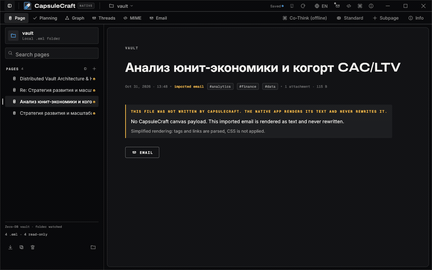

<div align="center">


# CapsuleCraft

### Ваша база знаний — это папка с письмами.

**Локальный редактор заметок и планировщик без базы данных, облака и аккаунтов —
каждая заметка, задача и таблица данных это обычный RFC 5322 `.eml`-файл на вашем диске.**

[](https://github.com/kostyk348/CapsuleCraft/releases)
[](https://github.com/kostyk348/CapsuleCraft/actions/workflows/ci.yml)
[](native/)
[](LICENSE)
[](#почему-eml)
[](#сильные-стороны)
[](CONTRIBUTING.md)

**Русский** · [English](README.md)

</div>

---



## Что такое CapsuleCraft?

Настольное приложение для мышления. Каждая страница — настоящий файл почтового
формата (`.eml`, RFC 5322 / RFC 2045): открывается в Thunderbird, ищется через
`grep`, диффится в `git`, резервируется `rsync`, синхронизируется Syncthing.
CapsuleCraft добавляет редактор, поиск, планирование и структуру — файлы
остаются вашими.

- 🗂 **Zero-DB** — папка `.eml`-файлов и есть вся база знаний.
- 🛰 **Офлайн по дизайну** — разбор MIME, поиск, ИИ и планирование работают локально; само приложение не делает сетевых вызовов.
- 🤖 **Офлайн Co-Thinker** — детерминированная локальная критика и анализ данных. Без API-ключей и облака.
- 🖥 **Малая нативная оболочка** — Rust + egui, без браузерного движка. Поставляется как AppImage **без вшитых библиотек**.

CapsuleCraft стартует **пустым** — никаких демо-заметок и заполнителей.
Встроенный **FAQ** (кнопка `ⓘ FAQ`, клавиша `F1` или командная палитра)
прямо в приложении отвечает на вопросы о хранении, поиске и переносе данных.

## Скриншоты (из настоящего приложения)

| Страница | Поиск (BM25) |
|---|---|
|  |  |
| **Обратные ссылки** | **Планирование** |
|  |  |
| **FAQ (встроенный)** | **Граф** |
|  |  |

<details>
<summary><b>Ещё вьюхи</b> — треды, MIME, вид письма</summary>

| Треды | MIME-инспектор |
|---|---|
|  |  |
| **Вид письма** | |
|  | |

</details>

## Возможности

- **Блочный редактор** — заголовки, абзацы, задачи, callout'ы, код, таблицы
  из CSV, аудиовложения; автосохранение, undo/redo, полный `.eml` round-trip.
- **`[[Вики-ссылки]]`** — выделяются прямо в тексте, кликабельны, с живым
  индексом обратных ссылок («Linked from»); переименование страницы обновляет
  все ссылки.
- **Поиск** — Okapi BM25 по всему хранилищу с баллами релевантности,
  подсветкой выдержек и учётом кириллицы; «Похожие по смыслу» ранжирует
  страницы tf-idf-косинусом по тому же индексу.
- **Планирование** — все задачи хранилища собираются в повестку, канбан,
  гантт (со стрелками зависимостей и защитой от циклов) и календарь,
  с экспортом ICS (RFC 5545).
- **Треды** — ответы это дочерние `.eml` с заголовками `In-Reply-To` /
  `References`, ровно как в почте: дерево размышлений живёт в стандарте.
- **Данные** — CSV/JSON едут как MIME-части и адресуются через `Content-ID`;
  datagrid-блоки показывают их таблицами, а ячейки-формулы `=SUM(A1:A5)`
  считает встроенный офлайн-JS-движок — и в браузере, и в нативной оболочке.
- **Воспроизведение аудио в native shell** — аудиозаметки из MIME-частей
  играют прямо в egui (rodio: WAV/MP3/OGG/FLAC) с кнопками Play/Pause/Stop.
- **Шифрование капсул OpenPGP** — любую капсулу можно экспортировать в
  бронированный `.eml.asc` с шифрованием по парольной фразе (AES-256,
  SEIPD v1 через rPGP) и импортировать обратно тем же диалогом; полностью
  офлайн, бинарник gpg не нужен.
- **Офлайн-исполнение кода** — JavaScript-блоки REPL работают в native shell
  через встроенный движок boa (веб-сборка — песочница в Web Worker);
  JSON валидируется и форматируется; Python/Rust честно сообщают, что
  интерпретатора в zero-dependency-сборке нет.
- **Импорт** — перетащите `.eml` в окно (байт-в-байт), импорт по IMAP или
  перенос готового хранилища Obsidian (`--import-obsidian`).
- **Готовность к ИИ-агентам** — хранилище открывается наружу через
  [MCP](https://modelcontextprotocol.io): Claude, Cursor и любой MCP-клиент
  может читать и искать вашу базу. Встроенный Co-Thinker при этом спорит
  с вашими тезисами офлайн.
- **Встроенный FAQ и snapshot CLI** — `--snapshot` рендерит настоящее окно
  в PNG (так сделан каждый скриншот выше). Интерфейс на русском и английском.

## Почему `.eml`?

Большинство приложений запирают знания в базу, которая умирает вместе с ними.
CapsuleCraft переворачивает это: одна страница = один текстовый файл.

| | Обычное PKM-приложение | CapsuleCraft |
|---|---|---|
| Хранение | закрытая база | обычные `.eml`-файлы |
| Чем открывается | только приложением | любым почтовым клиентом, `grep`, `git` |
| Экспорт | конвертация с потерями | файл и есть экспорт |
| Миграции | с обновлениями | не нужны никогда |
| Телеметрия / аккаунты | зависит от вендора | нет — папка и есть приложение |

## Формат капсулы

```eml
Message-ID: <capsule-1755000000000@vault.local>
Subject: Q4 pricing experiment
From: Owner <owner@vault.local>
To: Vault <vault@capsuleos.local>
X-Capsule-Tags: pricing, experiment

--capsule-boundary
Content-Type: application/json; name="blocks.json"
Content-ID: <blocks_json>

[{"id":"blk_1","type":"heading","data":{"level":1,"text":"Q4 pricing experiment"}}]
--capsule-boundary
Content-Type: text/csv; name="cohorts.csv"
Content-ID: <dataset_cohorts_csv>

cohort,users,conversion
Q4-A,1200,0.041
--capsule-boundary--
```

JSON-часть — структурный блочный канвас; остальные части — датасеты и вложения,
адресуемые через `Content-ID`. Треды едут на стандартных почтовых заголовках.

## Сравнение с Obsidian, OneNote и Notion

| | **CapsuleCraft** | Obsidian | OneNote | Notion |
|---|---|---|---|---|
| Формат хранения | обычный `.eml` (открытый стандарт) | Markdown + скрытые данные приложения | проприетарные бинарные секции | проприетарная облачная база |
| Полностью офлайн | ✅ по дизайну | ✅ | ⚠️ в основном | ⚠️ ограниченно |
| Нужен аккаунт | ❌ никогда | ❌ (для платной синхронизации да) | ✅ аккаунт Microsoft | ✅ для синхронизации |
| Данные читаются без приложения | ✅ Thunderbird / mutt / `grep` | ✅ Markdown | ❌ | ❌ (только экспорт) |
| Диффится в `git`, ищется `grep` и `rsync` | ✅ нативно | ✅ | ❌ | ❌ |
| Настоящие почтовые треды | ✅ `In-Reply-To`/`References` | ❌ | ❌ | ❌ |
| Локальный детерминированный ИИ | ✅ Co-Thinker | ⚠️ плагины/облако | ⚠️ Copilot (облако) | ⚠️ облако |
| Открытый код | ✅ MIT | ❌ (бесплатен, но закрыт) | ❌ | ❌ |
| Размер установки (Linux) | AppImage ~11 МБ, без webview | ~100 МБ Electron | 100+ МБ | веб-приложение |
| Зависимость от вендора | нет | низкая | высокая | высокая |

**Где Obsidian/OneNote сильнее сегодня:** экосистема плагинов Obsidian,
глубина стилуса OneNote, совместное облачное редактирование Notion.
CapsuleCraft нарочно уже: локальное хранение, которому можно верить десятилетиями.

## Сильные стороны

- **Данные переживают приложение.** Удалите CapsuleCraft завтра — Thunderbird
  по-прежнему откроет каждую заметку. Ни миграций, ни конвертаций — никогда.
- **Приватность структурная.** Без аккаунтов, телеметрии, API-ключей и сетевых
  вызовов. ИИ работает офлайн, потому что это единственный честный вариант.
- **Мало и быстро.** В нативной оболочке нет браузерного движка: AppImage
  на 8–12 МБ, мгновенный старт, только glibc в зависимостях.
- **Честный старт.** Пустое хранилище и встроенный FAQ — без демо-заметок
  под видом данных. Известные пробелы — в [LIMITATIONS.md](LIMITATIONS.md),
  а не спрятаны в маркетинге.
- **Есть путь миграции.** Импорт из Obsidian, IMAP-синхронизация и импорт
  `.eml` приносят реальные данные с первого дня.

## Начало работы

### Скачать

**Нативный AppImage** (рекомендуется, Linux):

```bash
chmod +x CapsuleCraft_1.9.0_amd64.AppImage
./CapsuleCraft_1.9.0_amd64.AppImage              # хранилище по умолчанию...
./CapsuleCraft_1.9.0_amd64.AppImage /path/to/vault   # ...или ваша папка
```

Нужны только glibc и рабочий стол X11 или Wayland — никаких WebKitGTK,
WebView2 и прочего. К каждому релизу прилагается `SHA256SUMS.txt`.

**Нативное приложение для Windows** (x64) — `CapsuleCraft_native_1.9.0_x64.zip`:
распакуйте в любую папку и запустите `CapsuleCraft.exe`. Автономный нативный egui-клиент
без WebView2 и без необходимости установки.

**Нативное приложение для macOS** (arm64) — `CapsuleCraft_native_1.9.0_arm64.app.zip`:
распакуйте, перетащите `CapsuleCraft.app` в «Программы». Подпись ad-hoc; если
Gatekeeper блокирует первый запуск: `xattr -d com.apple.quarantine CapsuleCraft.app`.

Legacy web/Tauri-сборки (Windows MSI / NSIS, Linux deb, macOS dmg) продолжают
публиковаться для паритета (в Linux им нужен `libwebkit2gtk-4.1-0`). Нативные сборки
для Linux (**AppImage**), Windows (**zip**) и macOS (**.app**) — это рекомендуемый
выбор: без браузерного движка и webview-библиотек.

> При первом запуске — пустое хранилище и встроенный **FAQ**: клавиша `F1`,
> кнопка `ⓘ FAQ` или ⌘K → FAQ. Демо-заметки не создаются никогда.

### Сборка из исходников

```bash
git clone https://github.com/kostyk348/CapsuleCraft.git
cd capsuleos/native
cargo run --release -- /path/to/your/vault
```

Для нативной сборки нужен только stable-Rust, без GUI-библиотек.

### Snapshot CLI (для документации и CI)

```bash
cargo run --release -- --snapshot out.png --page 1 [--view app] [--search "запрос"] [--scroll 300]
```

## Архитектура (native shell)

```text
native/src/
  main.rs        вход, разбор аргументов, FAQ-модалка, snapshot CLI
  cli.rs         типизированный CLI
  mail.rs        разбор и сериализация RFC 5322 / MIME
  mime.rs        разделение частей, реестр Media-Type, датасеты
  blocks.rs      дерево блоков <-> markdown-ish round trip
  page.rs        модель страницы, порядок, дерево
  links.rs       [[вики-ссылки]], индекс обратных ссылок
  graph.rs       DAG связей капсул
  threads.rs     треды из In-Reply-To / References
  planning.rs    повестка / канбан / гантт, экспорт ICS
  search.rs      BM25-индекс по всему хранилищу
  mcp.rs         конфиг MCP-сервера для ИИ-агентов
  sync_imap.rs   синхронизация аккаунтов IMAP
  secrets.rs     хранение аккаунтов в keyring
  i18n.rs        строки RU / EN
  ...
  views/         страница, граф, почта, mime, планирование, треды, палитра
```

## Тесты

```bash
# native shell
cd native
cargo test          # 133 unit-теста

# legacy web engine
npm ci
npx vitest run      # 172 теста
```

## Релизы

| Версия | Что | Когда |
|---|---|---|
| **v1.9.0** | Трио фич роадмапа в native shell: воспроизведение аудио (rodio), шифрование `.eml.asc` по OpenPGP (rPGP), исполнение кода и табличные формулы (boa); полный английский интерфейс с тестом на пуризм | 2026-10-31 |
| **v1.8.1** | Пересобран релизный конвейер: нативная portable-сборка Windows, релиз создаётся заранее (артефакты больше не теряются), единый `SHA256SUMS.txt`, тесты нативного ядра в CI | 2026-10-27 |
| **v1.8.0** | Двухуровневый хедер, Zen-режим, широкий холст; сборки macOS arm64; укрепление AppImage | 2026-10-26 |
| **v1.7.0** | Встроенный FAQ в оболочке; нигде нет демо-заметок; обновлённый README | 2026-10-25 |
| **v1.6.0** | Нативный автономный AppImage (без вшитых библиотек) | 2026-10-25 |
| **v1.5.0** | Переименование в CapsuleCraft; native egui shell | 2026-10-23 |
| **v1.4.0** | Планирование (Agenda/Kanban/Gantt/ICS); импорт почты | 2026-10-22 |
| **v1.3.0** | Офлайн-движок Co-Thinker | 2026-09-25 |
| **v1.2.0** | Поиск BM25; установщики Linux | 2026-09-15 |
| **v1.1.0** | Настоящее воспроизведение аудио | 2026-09-05 |
| **v1.0.0** | Первый релиз на Tauri | 2026-08-16 |

## Ограничения (честные)

См. [`LIMITATIONS.md`](LIMITATIONS.md). Главное: воспроизведение аудио
покрывает WAV/MP3/OGG/FLAC (веб-записи webm/opus требуют конвертации), JS-движок
не выполняет таймеры и ввод-вывод, синхронизация хранилища по-прежнему ручная.

## Роадмап

- ✅ v1.0 – v1.9 (текущий milestone)
- ✅ Нативное исполнение кода (REPL / табличные формулы JS) — готово в v1.9.0 (boa)
- ✅ Воспроизведение аудио в native shell — готово в v1.9.0 (rodio)
- ✅ GPG-шифрование капсул — готово в v1.9.0 (rPGP, `.eml.asc` с парольной фразой)
- ✅ Сборки macOS в CI (arm64)
- ⬜ Опциональная E2E-шифрованная синхронизация vault (tamper/censor-proof, всё ещё zero-cloud)

## Участие в разработке

PR приветствуются — см. [`CONTRIBUTING.md`](CONTRIBUTING.md). Изменения
отслеживаются в [`CHANGELOG.md`](CHANGELOG.md).

## Контрибьюторы

- **Konstantin** ([@kostyk348](https://github.com/kostyk348)) — автор, архитектура, native shell, релизы
- **kobaltGIT** ([@kobaltgit](https://github.com/kobaltgit)) — нативный UI и MIME-парсер, слежение за vault, офлайн Co-Thinker, MCP-сервер, импорт из Obsidian, drag & drop иерархии, IMAP-синхронизация; текущий редизайн GUI (двухуровневый хедер, Zen-режим, широкий холст)

## Лицензия

MIT — см. [`LICENSE`](LICENSE).

<div align="center">

**CapsuleCraft** — ваши мысли, хранящиеся как почта.

</div>
