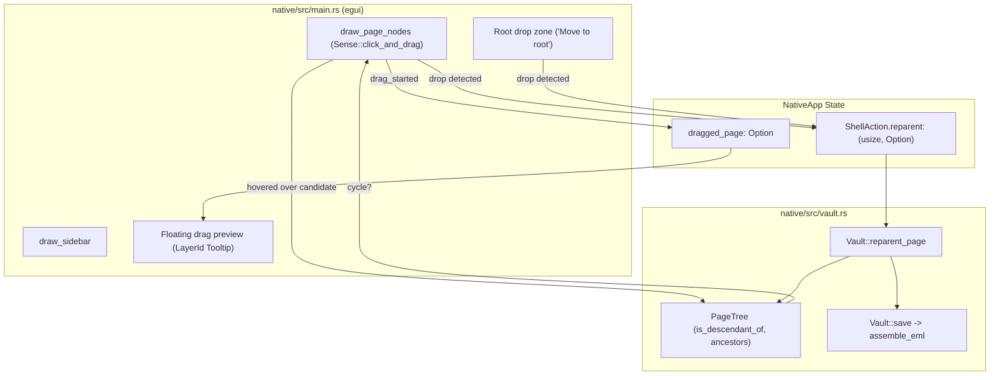

# Иерархия страниц и Drag-and-Drop в нативном клиенте — Руководство для мейнтейнера

Данный документ содержит полное техническое описание архитектуры и реализации интерактивной иерархии страниц, механизма Drag-and-Drop (DnD) и защиты от циклических зависимостей в нативном приложении CapsuleCraft / CapsuleOS (`native/src/vault.rs`, `native/src/main.rs`, `native/src/i18n.rs`).

---

## 1. Концепция и назначение

В CapsuleCraft страницы представляют собой автономные `.eml` файлы (Zero-DB / Pure-MIME). Взаимосвязь между страницами задается заголовком `X-Capsule-Page-Parent: <message-id>` по стандарту RFC 5322.

До появления функционала Drag-and-Drop реорганизация дерева страниц требовала ручного ввода Message-ID в свойствах или правки сырых файлов.

Новая подсистема Drag-and-Drop в боковой панели нативного приложения решает три ключевые задачи:
1. **Интуитивное изменение иерархии (Reparenting):** перетаскивание одной страницы на другую делает её дочерней.
2. **Перемещение страницы в корень (Promote to root):** сброс страницы в выделенную зону внизу списка делает её корневой (удаляя заголовок `X-Capsule-Page-Parent`).
3. **Строгая защита от циклов (Cycle Guard):** мгновенная детекция и визуальная блокировка попыток сбросить родительскую страницу внутрь её собственного поддерева (например, перенос предка в дочерний или внучатый узел).

---

## 2. Архитектура и структура модулей



### Основные компоненты

| Файл | Компонент | Роль в системе |
|---|---|---|
| `native/src/vault.rs` | `PageTree::is_descendant_of` | Рекурсивный обход дерева родителей для детекции циклов (быстрый O(depth)). |
| `native/src/vault.rs` | `Vault::reparent_page` | Обновление `capsule.parent_id`, валидация циклов, запись в файл `.eml` через `save()`. |
| `native/src/main.rs` | `draw_page_nodes` | Обработка жестов `click_and_drag`, подсветка целей (`ACCENT` / `BAD`), отрисовка плавающего бейджа перетаскивания. |
| `native/src/main.rs` | `draw_sidebar` | Зона сброса в корень (`Move to root`), фиксация события `pointer.any_released()`, формирование действия `ShellAction.reparent`. |
| `native/src/i18n.rs` | `Key::MakeChildOf`, `Key::MoveToRoot`, `Key::CannotDropInsideSelf` | Полная русская и английская локализация UI-подсказок и тултипов. |

---

## 3. Детали реализации

### 3.1. Детекция предков и защита от циклов (`PageTree::is_descendant_of`)

Метод проверяет, является ли узел `node` потомком потенциального предка `ancestor`:

```rust
pub fn is_descendant_of(&self, node: usize, ancestor: usize) -> bool {
    if node == ancestor {
        return false;
    }
    let mut current = self.parent_of(node);
    let mut seen = HashSet::new();
    seen.insert(node);
    while let Some(parent) = current {
        if parent == ancestor {
            return true;
        }
        if !seen.insert(parent) {
            break;
        }
        current = self.parent_of(parent);
    }
    false
}
```

* **Ограничение циклов:** структура `seen: HashSet<usize>` гарантирует отсутствие бесконечных циклов даже при обработке некорректных файлов, отредактированных пользователем вручную.
* **Производительность:** глубина дерева в типовых базах знаний редко превышает 5–10 уровней, проверка выполняется за доли микросекунды без аллокации тяжелых структур.

### 3.2. Мутация и сохранение (`Vault::reparent_page`)

Метод вызывается при завершении операции Drop:

```rust
pub fn reparent_page(&mut self, index: usize, new_parent_id: Option<String>) -> Result<(), String> {
    if index >= self.capsules.len() {
        return Err("Invalid page index".to_string());
    }

    // Защита от циклов на уровне доменной логики
    if let Some(target_id) = new_parent_id.as_deref().map(str::trim).filter(|s| !s.is_empty()) {
        let this_id = &self.capsules[index].message_id;
        if target_id == this_id {
            return Err("Cannot reparent page to itself".to_string());
        }

        let tree = PageTree::build(&self.capsules);
        if let Some(target_idx) = self.capsules.iter().position(|c| c.message_id == target_id) {
            if tree.is_descendant_of(target_idx, index) {
                return Err("Cannot reparent page inside its own subtree (cycle detected)".to_string());
            }
        }
    }

    let capsule = &mut self.capsules[index];
    capsule.parent_id = new_parent_id.filter(|s| !s.trim().is_empty());
    self.save(index)?;
    Ok(())
}
```

При установке `new_parent_id = None` поле очищается, а функция `mime::assemble_eml` не генерирует заголовок `X-Capsule-Page-Parent`, переводя страницу в корень дерева.

### 3.3. Пользовательский интерфейс и состояния курсора

1. **Инициация перетаскивания:**
   * Строки дерева используют `Sense::click_and_drag()`.
   * При `response.drag_started()` проверяется флаг `capsule.native`: перетаскивать разрешено только нативные страницы CapsuleCraft (внешние email-сообщения защищены от изменения).
   * Состояние `dragged_page: Option<usize>` сохраняется в структуре `NativeApp`.

2. **Визуальная индикация во время Drag:**
   * **Исходный элемент:** отрисовывается с контуром `theme::fade(theme::LINE, 0.4)` и приглушенным текстом.
   * **Плавающий бейдж курсора:** рендерится в оверлейном слое тултипов (`egui::Order::Tooltip`):
     - Полупрозрачная плашка со скруглением `theme::RADIUS`.
     - Рамка акцентного цвета `theme::ACCENT`.
     - Усеченный заголовок перетаскиваемой страницы (`truncate_chars(&capsule.subject, 18)`).
   * **Валидная цель (Drop Target):**
     - Выделяется рамкой `theme::ACCENT` толщиной 1.5px и заливкой `theme::fade(theme::ACCENT, 0.15)`.
     - Тултип: *«Сделать дочерней для «[Название]»»* (`Make child of "[Title]"`).
   * **Невалидная цель (Цикл / потомок):**
     - Выделяется сигнальным красным цветом `theme::BAD` (`#f87171`) с рамкой 1.5px.
     - Тултип: *«Нельзя переместить внутрь собственного поддерева»* (`Cannot move inside its own subtree`).
     - Запись в `drop_target` блокируется.
   * **Зона перемещения в корень:**
     - Появляется внизу списка страниц при активном перетаскивании не-корневой страницы.
     - Подсвечивается при наведении с подсказкой *«Переместить в корень»* (`Move to root`).

3. **Завершение перетаскивания (Drop Event):**
   * При `ui.input(|i| i.pointer.any_released())`:
     - Если был зарегистрирован валидный `drop_target` — формируется действие `action.reparent = Some((dragged, target))`.
     - Очищается `dragged_page = None`.
     - Вызывается `vault.reparent_page(...)`, обновляются индексы связей (`refresh_links()`) и отображается тост об успехе или ошибке.

---

## 4. Инварианты и правила безопасности

1. **Неприкосновенность внешних писем:** импортированные email-сообщения (`native: false`) не могут быть источником перетаскивания.
2. **Идемпотентность перетаскивания:** если страница уже находится в корне, зона сброса в корень игнорирует наведение на неё.
3. **Сохранение ссылок и метаданных:** переименование родителя и изменение связей в дереве не меняет Message-ID страницы, поэтому `[[wiki-ссылки]]` между страницами остаются абсолютно валидными.
4. **Безотказность при ошибках диска:** при возникновении сбоя записи в файловой системе приложение показывает ошибку в статус-баре/тосте, не приводя к панике UI-потока.

---

## 5. Тестирование и верификация

Все тесты запускаются с обязательным ограничением потоков по генеральному регламенту:

```powershell
cd native
cargo test vault::tests -j 1
```

### Автоматические тесты (`native/src/vault.rs`)

* **`test_is_descendant_of`:** проверяет транзитивность родства на многоуровневом дереве (`a2 -> a1 -> a -> root`), корректность обнаружения ложных связей для соседних веток и исключение самородства.
* **`test_reparent_page`:**
  - Создает временное хранилище на диске;
  - Создает 3 независимые страницы;
  - Проверяет успешный reparenting `p2 -> p1` и `p3 -> p2`;
  - Проверяет блокировку попытки цикла `p1 -> p3` с получением ошибки `"cycle detected"`;
  - Проверяет успешный перенос `p2` обратно в корень дерева (`parent_id: None`).

---

## 6. Рекомендации по дальнейшему развитию

1. **Drag-to-Reorder (Пользовательская сортировка внутри уровня):**
   * В текущей версии страницы сортируются по алфавиту/дате (`PageTree::build`).
   * Для поддержки произвольного порядка братьев потребуется добавить необязательный заголовок `X-Capsule-Page-Order: <float|int>` в манифест MIME.
2. **Анимация раскрытия ветки при удержании курсора (Hover-to-Expand):**
   * Если пользователь держит перетаскиваемую страницу над свернутой папкой в течение 500 мс — автоматически раскрывать узел (`collapsed.remove(&key)`).
