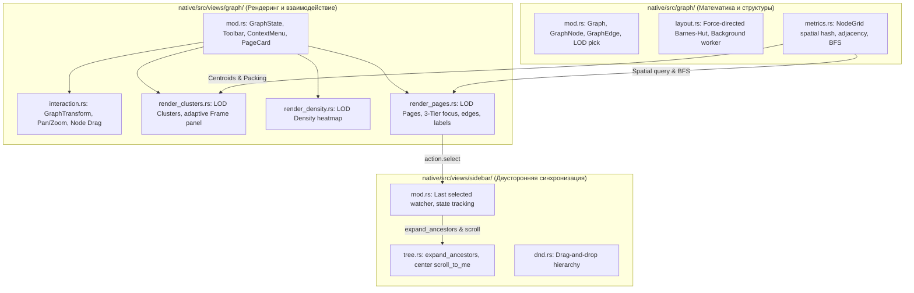
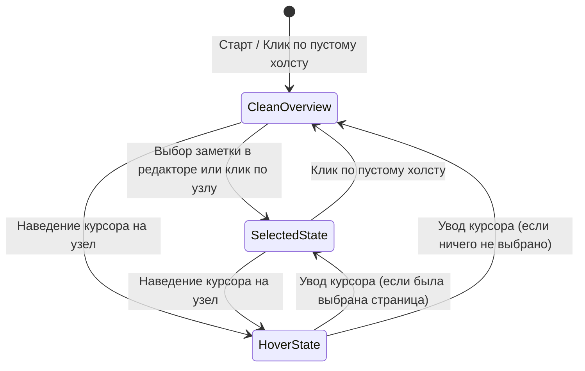

# Интерактивный граф отношений и трёхслойная модель фокуса — Руководство для мейнтейнера

Данный документ содержит полное архитектурное и техническое описание интерактивного графа отношений, трёхслойной модели фокуса (**3-Tier Focus Hierarchy**), BFS-подсистемы локального графа, фильтрации и двусторонней синхронизации с сайдбаром в нативном клиенте CapsuleCraft / CapsuleOS (`native/src/graph/`, `native/src/views/graph/`, `native/src/views/sidebar/`, `native/src/i18n.rs`).

---

## 1. Концепция и назначение

Граф отношений в CapsuleCraft строит карту связей между автономными `.eml` файлами на основе заголовков `X-Capsule-Page-Parent`, почтовых ответов `In-Reply-To`/`References`, вики-ссылок `[[...]]` и общих тегов.

Ранее граф страдал от трёх архитектурных и UX-ограничений:
1. **Монолитная кодовая база:** `graph.rs`, `graph_view.rs` и `sidebar_view.rs` представляли собой монолиты свыше 1,100–1,350 строк каждый, что усложняло поддержку и приводило к дублированию логики.
2. **Статичность и отсутствие инспекции связей:** узлы нельзя было перемещать, клик не подсвечивал окрестность, а при открытии графа 90% хранилища было глубоко затемнено (до 20% яркости), создавая эффект «серого тумана».
3. **Отсутствие фокусных инструментов:** не было локального графа для работы со сложными сетями, поиска по именам заметок, фильтра сирот и контекстных действий по правой кнопке мыши.

Реализованный комплекс нововведений превращает граф в полноценный интерактивный рабочий стол для визуального мышления уровня Obsidian и Roam Research с сохранением строгой легковесности и Zero-Main Bloat.

---

## 2. Архитектура и декомпозиция модулей

Все монолитные файлы были декомпозированы на компактные подмодули с соблюдением лимита в 500–800 строк на файл:



### Модули и их ответственность

| Файл | Строк | Зона ответственности |
|---|---|---|
| [`native/src/graph/mod.rs`](file:///d:/Projects/active/capsuleos/native/src/graph/mod.rs) | ~570 | Доменные структуры графа, построение рёбер по MIME-заголовкам и ссылкам, выбор LOD. |
| [`native/src/graph/layout.rs`](file:///d:/Projects/active/capsuleos/native/src/graph/layout.rs) | ~480 | Силовая раскладка графа, адаптивные итерации, фоновый расчёт в канале `std::sync::mpsc`. |
| [`native/src/graph/metrics.rs`](file:///d:/Projects/active/capsuleos/native/src/graph/metrics.rs) | ~313 | Пространственный хэш-грид `NodeGrid`, список смежности `adjacency`, алгоритм `neighborhood_bfs`. |
| [`native/src/views/graph/mod.rs`](file:///d:/Projects/active/capsuleos/native/src/views/graph/mod.rs) | ~779 | Состояние `GraphState`, тулбар, контекстное меню ПКМ, карточка выбранной страницы на `egui::Frame`. |
| [`native/src/views/graph/interaction.rs`](file:///d:/Projects/active/capsuleos/native/src/views/graph/interaction.rs) | ~107 | Координатный преобразователь `GraphTransform`, обработка панорамирования, зума и перетаскивания узлов. |
| [`native/src/views/graph/render_pages.rs`](file:///d:/Projects/active/capsuleos/native/src/views/graph/render_pages.rs) | ~388 | Детальный рендеринг уровня страниц: 3-уровневый фокус, инцидентные связи `2.2px`, световые ореолы, подписи. |
| [`native/src/views/graph/render_clusters.rs`](file:///d:/Projects/active/capsuleos/native/src/views/graph/render_clusters.rs) | ~347 | Рендеринг кластеров, алгоритм пузырьковой упаковки, плашка кластеров на `egui::Frame`. |
| [`native/src/views/sidebar/tree.rs`](file:///d:/Projects/active/capsuleos/native/src/views/sidebar/tree.rs) | ~377 | Дерево страниц, функция `expand_ancestors`, автоматический скролл к выбранной строке. |

---

## 3. Ключевые нововведения и механики

### 3.1. Трёхслойная модель фокуса (3-Tier Focus Hierarchy)

Вместо постоянного 20% затемнения внедрена естественная трёхуровневая модель:



1. **Состояние 1: «Чистый обзор» (100% яркость):**
   - Действует, когда ни один узел не выбран, либо после клика по свободному пространству холста.
   - Все узлы отображаются в полных цветах своих кластеров со **100% яркостью** (`dim = 1.0`).
   - Рёбра и подписи отрисовываются на **100% контрастности** без угасания.
2. **Состояние 2: «Выбрана страница» (85% фон):**
   - Выбранная заметка сияет двойным акцентным ореолом свечения (`circle_filled`), её инцидентные связи выделены.
   - Фон (весь остальной граф) мягко приглушается всего до **85%** (`dim = 0.85`, рёбра `0.80`, подписи `0.85`). База остаётся полностью читаемой и структурированной.
3. **Состояние 3: «Наведение курсора» (22% глубокий рентген связей):**
   - При наведении мыши на любой узел (`hovered.is_some()`) включается точечный анализ: узел и его соседи горят на 100%, инцидентные связи выводятся акцентными линиями `2.2px`.
   - Несвязанный фон затухает до **22%**, отсекая визуальный шум на время инспекции.
4. **Сброс выделения по клику на холст (Click-to-Deselect):**
   - Короткий клик левой кнопкой мыши по холсту (без драга) выставляет `state.selection_cleared = true`, моментально поднимая яркость всего графа на 100% и скрывая карточку страницы. При выборе другой заметки из сайдбара фокус мгновенно восстанавливается.

---

### 3.2. Изолированный $O(1)$ драг узлов

* При зажатии ЛКМ на узле в `LodMode::Pages` узел захватывается (`dragged_node = Some(slot)`).
* Позиция смещается в реальном времени с нулевым оверхедом через временную таблицу `drag_overrides: HashMap<u32, [f32; 2]>`. Никакой перераскладки всего графа не происходит ($O(1)$ на кадр).
* При отпускании мыши (`drag_stopped`) итоговые мировые координаты коммитятся в `PositionCache` (`graph_layout.json`) и сохраняются на диск.
* Курсор мыши переключается между `Grab` (при наведении) и `Grabbing` (при перетаскивании).

---

### 3.3. Режим «Локальный граф» (Local Graph)

* В тулбар добавлена кнопка переключения: «Глобальный граф» $\leftrightarrow$ «Локальный граф: Глубина 1..3».
* Построение подграфа выполняется методом `neighborhood_bfs(start, depth)` в `GraphMetrics` по списку смежности `adjacency`.
* На экран выводятся **только** узлы, находящиеся на расстоянии не более $k$ шагов от выбранной заметки. Все остальные узлы и рёбра отсекаются из цикла рендеринга, обеспечивая чистый изолированный контекст для глубокого анализа темы.

---

### 3.4. Поиск по графу и фильтр сирот

* **Поиск (`search_query`):** поле ввода в тулбаре с кнопкой быстрой очистки. Узлы, совпавшие по заголовку, выделяются акцентным кольцом и световым ореолом, их подписи получают высший приоритет видимости (не отсекаются лимитом `LABEL_MAX`), а несовпавшие узлы приглушаются.
* **Скрыть сироты (`hide_orphans`):** кнопка-тумблер мгновенно скрывает из графа заметки с нулевой степенью связности (`degree == 0`), очищая рабочий стол от неструктурированных мыслей.

---

### 3.5. Контекстное меню по правой кнопке мыши (ПКМ)

* **ПКМ по узлу заметки:**
  - *«Открыть заметку»* — переход к странице в блочном редакторе (`View::Page`);
  - *«Копировать ссылку»* — копирование `capsule://<id>` в системный буфер обмена с всплывающим тостом;
  - *«Копировать [[вики-ссылку]]»* — копирование формата `[[Заголовок]]` в буфер обмена с тостом.
* **ПКМ по пустому холсту:**
  - *«Вписать»* — сброс масштаба и центрирование графа по экранным границам.

---

### 3.6. Автопрокрутка и синхронизация в сайдбаре (Zero-Main Bloat)

* В [`native/src/views/sidebar/tree.rs`](file:///d:/Projects/active/capsuleos/native/src/views/sidebar/tree.rs) добавлена функция `expand_ancestors`: поднимаясь по цепочке `PageTree::parent_of`, она гарантированно удаляет из набора `collapsed` все родительские папки выбранной страницы.
* Сайдбар инкапсулированно отслеживает смену выбора через контекст `egui` (`sidebar-last-selected`), раскрывает родителей и центрирует скролл:
  ```rust
  response.scroll_to_me(Some(egui::Align::Center));
  ```
* **Нулевые изменения в `NativeApp` и `main.rs`:** ядро приложения остаётся абсолютно чистым.

---

### 3.7. Адаптивные контейнеры `egui::Frame` (Анти-оверфлоу)

* Панель кластеров и карточка выбранной заметки переведены с ручных прямоугольников `painter.rect` с захардкоженной высотой на самоадаптирующийся `egui::Frame`.
* Фон и рамка автоматически облегают контент любой длины (перенос длинных заголовков на несколько строк, вывод списка тегов), предотвращая выпадение элементов за пределы границы.

---

### 3.8. Векторный интерфейс (Vector-First UI)

* В строках интерфейса графа и тулбара **полностью отсутствуют** потенциально ломающиеся символы Unicode (`●`, `✓`, `⚙`, `🔍`) и эмодзи.
* Все маркеры статуса рисуются векторными примитивами `ui.painter().circle_filled`, а служебные кнопки используют системные векторные иконки `Icon`.

---

## 4. Локализация (i18n)

В словарь [`native/src/i18n.rs`](file:///d:/Projects/active/capsuleos/native/src/i18n.rs) добавлены новые ключи с синхронным двуязычным переводом:

| Ключ `Key` | Русский (`ru`) | Английский (`en`) |
|---|---|---|
| `GraphLocalMode` | «Локальный граф» | "Local graph" |
| `GraphGlobalMode` | «Глобальный граф» | "Global graph" |
| `GraphDepth` | «Глубина» | "Depth" |
| `GraphSearchPlaceholder` | «Поиск…» | "Search…" |
| `GraphHideOrphans` | «Скрыть сироты» | "Hide orphans" |
| `GraphContextMenuOpen` | «Открыть заметку» | "Open note" |
| `GraphContextMenuCopyLink` | «Копировать ссылку» | "Copy link" |
| `GraphContextMenuCopyWikiLink` | «Копировать [[вики-ссылку]]» | "Copy [[wiki link]]" |

Строгие тесты `english_strings_are_cyrillic_free` и `every_key_has_both_languages` подтверждают 100% структурную чистоту.

---

## 5. Верификация и метрики качества

1. **Компиляция с ограничением потоков (Resource Guard):**
   ```powershell
   cargo test --manifest-path native/Cargo.toml --lib -j 1
   cargo build --manifest-path native/Cargo.toml --bin capsuleos-native --release -j 1
   ```
2. **Результаты тестов:**
   $$\mathbf{320\ passed;\ 0\ failed;\ 2\ ignored;\ 0\ measured}$$
3. **Контроль размеров файлов (строгий лимит $< 800$ строк):**
   - `native/src/graph/mod.rs` — 571 строка
   - `native/src/graph/layout.rs` — 480 строк
   - `native/src/graph/metrics.rs` — 313 строк
   - `native/src/views/graph/mod.rs` — 779 строк
   - `native/src/views/graph/render_pages.rs` — 388 строк
   - `native/src/views/graph/render_clusters.rs` — 347 строк
   - `native/src/views/graph/interaction.rs` — 107 строк
   - `native/src/views/graph/render_density.rs` — 97 строк
   - `native/src/views/sidebar/mod.rs` — 718 строк
   - `native/src/views/sidebar/tree.rs` — 377 строк
   - `native/src/views/sidebar/dnd.rs` — 98 строк

---

## 6. История коммитов ветки `feat/graph-interactive-enhancement`

1. `0577df5` — *refactor(graph): stage 0 — decompose graph, graph_view, and sidebar_view monoliths*
2. `5e73373` — *feat(graph): stage 1 — interactive node drag, connected neighborhood highlighting, and frame cluster panel*
3. `f8741b6` — *feat(sidebar): stage 2 — auto-expand ancestors and center scroll on selection*
4. `2baa2b0` — *feat(graph): stage 3 — local graph mode, search highlight, orphan filter, context menu and i18n*
5. `5a55304` — *feat(graph): 3-tier focus hierarchy and canvas click-to-deselect*
6. `59b2aa8` — *fix(graph): adaptive frame height for selected page card*
