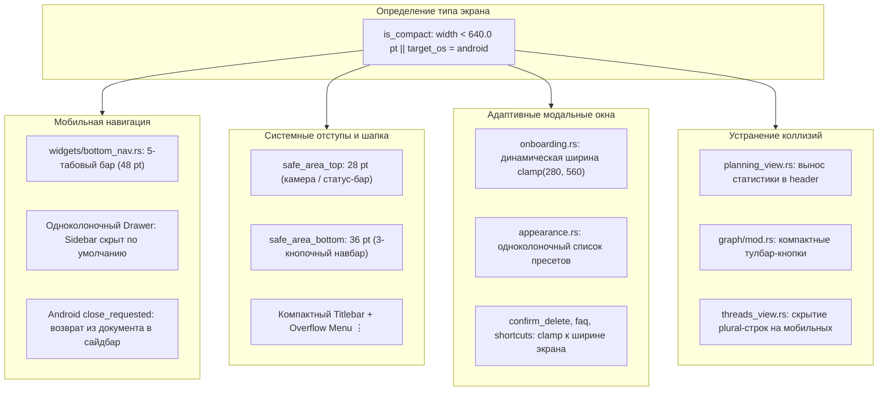

# Адаптивный мобильный интерфейс и поддержка Android — Руководство для мейнтейнера

Данный документ содержит полное архитектурное и техническое описание адаптации графического интерфейса под мобильные устройства и платформу Android в клиенте CapsuleCraft / CapsuleOS (`native/src/widgets/bottom_nav.rs`, `native/src/widgets/titlebar.rs`, `native/src/modals/`, `native/src/views/`, `native/src/main.rs`).

---

## 1. Концепция и решаемые проблемы

Начиная с версии v2.9.0 и фикса v2.12.4 (`DT_NEEDED libc++_shared.so`), нативный egui-клиент успешно собирается как Android `NativeActivity` (`libcapsuleos_native.so`, arm64-v8a). Однако визуально приложение запускалось в исходной десктопной компоновке, что создавало критические проблемы удобства использования (UX) на экранах смартфонов:

1. **Жесткая фиксация размеров диалоговых окон:**
   Модальные окна (приветственный тур `onboarding.rs`, выбор темы `appearance.rs`, справка `faq.rs` и др.) имели жестко заданную десктопную ширину (560–720 pt). На экранах смартфонов (ширина 360–412 pt) более трети содержимого оказывалось за пределами экрана, из-за чего кнопки навигации («Далее», «Закрыть») были физически недоступны.
2. **Отсутствие мобильной навигации и коллизии тулбаров:**
   Десктопная панель `WorkspaceStrip` занимала полезную вертикаль, а в представлениях «Планирование» (`planning_view.rs`), «Граф» (`graph/mod.rs`) и «Треды» (`threads_view.rs`) элементы управления слева и блоки статистики справа рисовались в одну строку, вызывая взаимное перекрытие и наложение текста на экранах `< 600 pt`.
3. **Неудобный запуск и отсутствие одноколоночного режима:**
   При открытии приложения пользователь сразу видел раскрытый на весь экран пустой сайдбар (файловое дерево с 0 страниц), вместо готового к работе редактора или приветственного экрана.
4. **Игнорирование системных зон Android (Safe Area):**
   Интерфейс накладывался на системную строку состояния/вырез фронтальной камеры сверху и классическую трехкнопочную навигационную полосу (`< O |||`) снизу.
5. **Отсутствие отладочного вывода паник:**
   При сбоях в рантайме процесс молча завершался без информативного стектрейса в системном журнале Android (`logcat`).

---

## 2. Архитектура мобильной адаптации



---

## 3. Детализация компонентов

### 3.1. Нижняя панель навигации ([`native/src/widgets/bottom_nav.rs`](file:///d:/Projects/active/capsuleos/native/src/widgets/bottom_nav.rs))
- Реализован отдельный компонент `draw_mobile_bottom_nav` высотой `48 pt` с 5 крупными сенсорными табами:
  1. **«Страница»** (`Icon::Doc`): переключение в режим заметок / переключение видимости сайдбара;
  2. **«Граф»** (`Icon::Graph`): интерактивный граф связей;
  3. **«Задачи»** (`Icon::Board`): планировщик задач;
  4. **«Треды»** (`Icon::Mail`): цепочки мыслей и ответов;
  5. **«Поиск»** (`Icon::Search`): палитра команд и глобальный поиск.
- Каждая кнопка содержит векторную иконку (18 pt), текстовую подпись и визуальную капсулу выделения для активного раздела.
- При включении компактного режима десктопный `WorkspaceStrip` автоматически скрывается, освобождая драгоценное вертикальное пространство.

### 3.2. Одноколоночный режим (Drawer Mode)
- На десктопе сайдбар и центральная панель отображаются бок о бок. На мобильных устройствах интерфейс автоматически работает в одноколоночном режиме:
  - При запуске приложение стартует с открытым редактором (`sidebar_collapsed = true`) либо аккуратным экраном `draw_empty_state` с вертикальными кнопками («Создать первую страницу», «FAQ», «Сменить папку»).
  - Открытие сайдбара разворачивает его на весь экран (Drawer).
  - Выбор любой заметки или создание новой страницы автоматически плавно сворачивает сайдбар.
  - Нажатие системной кнопки «Назад» на Android при закрытом сайдбаре разворачивает сайдбар (навигацию) вместо аварийного выхода из приложения.

### 3.3. Мобильное выпадающее меню шапки (`⋮`)
В шапке десктопные кнопки окна (`_ □ ✕`), декоративные разделители и бейдж `NATIVE` скрыты. Нажатие на трехточечный векторный значок `Icon::More` открывает меню действий:
- **«Синхронизировать папку»** (`action.sync_folder = true`): запуск локального двустороннего слияния;
- **«Синхронизация почты (IMAP)»** (`action.open_imap = true`): модальное окно почтовой синхронизации;
- **«Внешний вид»** (`action.appearance = true`): смена темы оформления и акцентных цветов;
- **«Команды и страницы»** (`action.palette = true`): быстрый вызов палитры без клавиатурного шортката `Ctrl+K`;
- **«Интеграции»**, **«Справка (FAQ)»**, **«Сменить язык (En/Ru)»**, **«Перечитать с диска»**, **«Сохранить»**.

### 3.4. Адаптивность диалоговых окон
Все модальные окна переведены с жестких размеров на динамические:
```rust
let is_compact = rect.width() < 600.0;
let panel_w = if is_compact {
    (rect.width() - 24.0).clamp(280.0, 560.0)
} else {
    560.0
};
let panel_h = if is_compact {
    (rect.height() - 60.0).clamp(320.0, 460.0)
} else {
    380.0
};
let panel = Rect::from_center_size(rect.center(), vec2(panel_w, panel_h));
```
- **`onboarding.rs`:** уменьшены паддинги (16 pt вместо 24 pt), уменьшены размеры шрифтов, сенсорные кнопки переведены на высоту 32 pt.
- **`appearance.rs`:** переключение списка пресетов тем с 2 колонок на 1 колонку при ширине `< 600 pt`.
- **`confirm_delete.rs`, `faq.rs`, `shortcuts.rs`:** ограничены шириной доступной области экрана минус системные отступы.

### 3.5. Устранение наложений в тулбарах представлений
- **Планирование (`planning_view.rs`):** ранее левая группа (сегментированные табы) и правая группа (статистика задач) размещались в одном прямоугольнике `bar_rect` с противоположными выравниваниями. На экране 360 pt текст «Повестка/Канбан/Гантт/Календарь» накладывался на «0 0% 0 ОТКРЫТО ГОТОВО». Исправлено: статистика на мобильных вынесена в подзаголовок страницы, а тулбар содержит только чистые табы.
- **Граф связей (`views/graph/mod.rs`):** скрыты длинные строковые метки подсказок и текстовые хвосты у кнопок фильтров, уменьшена базовая ширина поиска до 75 pt.
- **Треды (`threads_view.rs`):** скрыта длинная plural-строка статистики, освобождая место переключателю режима отображения.

### 3.6. Системная интеграция Android
- **Безопасные отступы (Safe Area Insets):**
  - `safe_area_top` (28 pt): защита от перекрытия статус-баром и вырезом камеры;
  - `safe_area_bottom` (36 pt): защита нижнего бара от наложения на системные кнопки Android (`< O |||`).
- **Служба логирования паник:**
  В `android_main` установлен глобальный обработчик паник Rust:
  ```rust
  std::panic::set_hook(Box::new(|info| {
      log::error!("CapsuleCraft panic: {info}");
  }));
  ```
- **Каталог настроек:**
  В `i18n::settings_dir()` добавлен безопасный fallback на `vault::app_data_dir()`, когда стандартные переменные `APPDATA`/`HOME`/`XDG_CONFIG_HOME` отсутствуют на телефоне.
- **Защита оконных операций:**
  Функции `chrome::title_bar_drag`, `chrome::title_bar_drag_rect` и `chrome::window_edges` отключаются под `target_os = "android"`.

---

## 4. Сводная таблица изменений

| Файл | Назначение изменений |
|---|---|
| [`native/src/widgets/bottom_nav.rs`](file:///d:/Projects/active/capsuleos/native/src/widgets/bottom_nav.rs) | **Новый модуль.** Реализация 5-табового сенсорного бара нижней навигации и тесты. |
| [`native/src/widgets/mod.rs`](file:///d:/Projects/active/capsuleos/native/src/widgets/mod.rs) | Регистрация и реэкспорт модуля `bottom_nav`. |
| [`native/src/widgets/titlebar.rs`](file:///d:/Projects/active/capsuleos/native/src/widgets/titlebar.rs) | Компактный режим шапки, значок `Icon::More` (`⋮`), выпадающее меню действий. |
| [`native/src/icons.rs`](file:///d:/Projects/active/capsuleos/native/src/icons.rs) | Добавлен векторный примитив `Icon::More` (вертикальное троеточие). |
| [`native/src/modals/onboarding.rs`](file:///d:/Projects/active/capsuleos/native/src/modals/onboarding.rs) | Адаптивная ширина приветственного тура, масштабирование шрифтов и тесты. |
| [`native/src/modals/appearance.rs`](file:///d:/Projects/active/capsuleos/native/src/modals/appearance.rs) | Одноколоночный адаптивный режим выбора тем. |
| [`native/src/modals/confirm_delete.rs`](file:///d:/Projects/active/capsuleos/native/src/modals/confirm_delete.rs) | Адаптивная ширина окна подтверждения удаления. |
| [`native/src/modals/faq.rs`](file:///d:/Projects/active/capsuleos/native/src/modals/faq.rs) | Адаптивная ширина окна справки. |
| [`native/src/modals/shortcuts.rs`](file:///d:/Projects/active/capsuleos/native/src/modals/shortcuts.rs) | Адаптивная ширина окна горячих клавиш. |
| [`native/src/views/document_view.rs`](file:///d:/Projects/active/capsuleos/native/src/views/document_view.rs) | Адаптивные отступы документа, вертикальные кнопки в `draw_empty_state`. |
| [`native/src/views/planning_view.rs`](file:///d:/Projects/active/capsuleos/native/src/views/planning_view.rs) | Устранение коллизии табов и статистики в тулбаре планировщика. |
| [`native/src/views/graph/mod.rs`](file:///d:/Projects/active/capsuleos/native/src/views/graph/mod.rs) | Компактный тулбар графа связей для экранов `< 600 pt`. |
| [`native/src/views/threads_view.rs`](file:///d:/Projects/active/capsuleos/native/src/views/threads_view.rs) | Устранение наложения plural-статистики в тредах. |
| [`native/src/chrome.rs`](file:///d:/Projects/active/capsuleos/native/src/chrome.rs) | Отключение кнопок окна и перетаскивания под Android. |
| [`native/src/i18n.rs`](file:///d:/Projects/active/capsuleos/native/src/i18n.rs) | Fallback настроек на `app_data_dir()`, добавление строки `NavSearch`. |
| [`native/src/main.rs`](file:///d:/Projects/active/capsuleos/native/src/main.rs) | Поддержка Safe Area, Bottom Nav, Drawer mode, panic hook, back button. |
| [`docs/android.md`](file:///d:/Projects/active/capsuleos/docs/android.md) | Документирование нововведений адаптивного мобильного UI. |
| [`.github/workflows/android.yml`](file:///d:/Projects/active/capsuleos/.github/workflows/android.yml) | Включение триггера автоматической сборки APK для веток `feat/**`. |

---

## 5. Тестирование и верификация

Все тесты воркспейса выполняются в строгом однопоточном режиме (`-j 1`):
```bash
cargo test --manifest-path native/Cargo.toml --lib -j 1
```

1. **Регрессионное тестирование:**
   Все 340 существующих unit- и интеграционных тестов ядра, хранилища, парсера, рендереров и графа проходят со 100% успехом.
2. **Специализированные мобильные тесты:**
   - `widgets::bottom_nav::tests::bottom_nav_renders_headlessly_on_mobile_width`: проверка корректности верстки бара на ширине 380 pt;
   - `widgets::bottom_nav::tests::bottom_nav_click_switches_view`: проверка переключения вкладок по сенсорным тапам;
   - `modals::onboarding::tests::onboarding_modal_renders_on_narrow_mobile_screen`: проверка рендеринга модального тура на экране 360x800 без переполнения;
   - `app_tests::compact_mobile_viewport_single_column_drawer_mode`: проверка поведения Drawer-режима и автоматического сворачивания при создании заметки.
3. **CI-верификация APK:**
   - GitHub Actions автоматически собирает `libcapsuleos_native.so`, пакует `libc++_shared.so` и выполняет проверку `scripts/check_apk_native_deps.py`, подтверждая полную работоспособность сборки под `arm64-v8a`.
