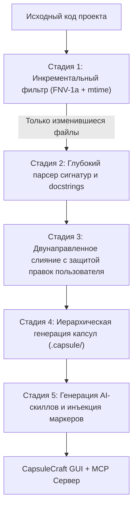

# Движок знаний о проектах CapsuleCraft (Project Knowledge Engine)

Документ предназначен для мейнтейнеров и архитекторов проекта CapsuleCraft. В нём детально раскрыта архитектура автоматического преобразования кодовых баз в локальные базы знаний, описана интеграция с AI-агентами, обоснована бизнес- и техническая польза внедрения, а также зафиксирован план дальнейшего развития (Roadmap).

---

## 1. Подробное описание механизма

### 1.1. Что и как делает движок

Механизм **Project Knowledge Engine** преобразует локальный репозиторий с исходным кодом (поддерживаются Rust, TypeScript, JavaScript, Python, Go, C#, Java, Dart, а также документация Markdown) в структурированную, взаимосвязанную базу знаний формата RFC 5322 (`.eml`), сохраняемую локально в директории `.capsule/`.

Работа механизма делится на 5 ключевых стадий:



#### Стадия 1: Инкрементальное сканирование и кэш состояний (`.capsule/.index_state.json`)
* Для каждого файла вычисляется 64-битный детерминированный хеш **FNV-1a** в связке с временем последней модификации (`mtime`) и размером файла.
* Состояние индекса сохраняется в `.capsule/.index_state.json`.
* При повторных вызовах неизменившиеся файлы отсекаются за доли миллисекунды. Пересканирование проекта из 500+ файлов при отсутствии изменений занимает **менее 30 мс** без лишней нагрузки на диск и процессор.
* **Автоматическая очистка сиротских файлов:** Если исходный файл был удален или переименован в репозитории, парсер выявляет это по кэшу и удаляет устаревшую `.eml`-капсулу из `.capsule/`, предотвращая накопление мертвого мусора.

#### Стадия 2: Глубокий парсинг сигнатур, docstrings и техдолга
* **Многострочный сбор сигнатур:** Парсер накапливает многострочные объявления функций, структур, классов, интерфейсов и типов с учетом дженериков, возвращаемых типов и модификаторов видимости:
  - Rust: `pub async fn`, `pub struct`, `pub trait`, `pub enum` с корректной обработкой переносов строк.
  - TypeScript / JavaScript: `export async function`, `export interface`, `export type`, `export class`.
  - Python: `def`, `class`, включая многострочные аргументы и аннотации типов.
  - Go, Dart, C#, Java: стандартные публичные методы и интерфейсы.
* **Извлечение комментариев и документации:**
  - Тройные слэши (`///`) и внутренние комментарии модулей (`//!`) в Rust/C#;
  - Блочные комментарии JSDoc/Javadoc (`/** ... */`);
  - Многострочные докстринги Python (`"""..."""` или `'''...'''`).
* **Агрегация технического долга:** Парсер сканирует весь код на маркеры `TODO`, `FIXME`, `BUG:`, `HACK:`, `NOTE:` с точным указанием относительного пути файла и номера строки.

#### Стадия 3: Гарантия сохранности пользовательских данных (Zero Data Loss)
* Все системные блоки, сгенерированные парсером, помечаются метаданными `"managed_by": "project_parser"`.
* При повторном обновлении капсулы модуль `write_capsule_preserving` выполняет извлечение пользовательского состояния:
  - Любые заметки, добавленные разработчиком вручную (текстовые параграфы, чек-листы, выноски);
  - Пользовательские теги (например, `#architecture`, `#refactor`, `#security`);
  - Кастомный статус капсулы (`wip`, `todo`, `done`);
  - **Визуальный холст Whiteboard (Canvas):** Прикрепленный файл `canvas_state.json` со всеми геометрическими фигурами, стрелками и карточками схемы архитектуры полностью сохраняется.
* Автоматическая миграция со старого плоского формата (`module_foo.eml`) в структурированный (`modules/module_foo.eml`) переносит данные пользователя без потерь.

#### Стадия 4: Иерархическая структура базы знаний
Файлы внутри `.capsule/` организуются по понятной архитектурной структуре:
* `.capsule/index.eml` — главная обзорная капсула проекта (метрики, списки подсистем, модулей и документации со ссылками вида `[[modules/foo.rs]]`).
* `.capsule/tasks_todo.eml` — агрегированный реестр всех задач и техдолга с чекбоксами.
* `.capsule/subsystems/` — архитектурные подсистемы (определяются по папкам верхнего уровня: `native`, `crates`, `frontend`, `services` и т.д.).
* `.capsule/modules/` — отдельные модули и файлы исходного кода с выжимкой их публичного API.
* `.capsule/docs/` — внутренняя проектная документация из Markdown-файлов.

#### Стадия 5: Интерфейс пользователя (UI/UX) в CapsuleCraft
* **Системный диалог выбора папки:** Пункт меню «Открыть проект как базу знаний...» вызывает нативный проводник (`rfd::FileDialog`). Пользователь выбирает любую директорию с кодом — парсер индексирует её и сразу переключает хранилище.
* **Кнопка быстрой синхронизации (`Icon::Reload`):** Находится на боковой панели и позволяет в один клик пересканировать текущий открытый проект, выводя уведомление с количеством обновленных и удаленных файлов.
* **Управление сворачиванием папок (Аккордеон):** Кнопка в заголовке страниц сайдбара (`ChevronDown` / `Folder`) позволяет в один клик свернуть или развернуть все подпапки (`modules/`, `subsystems/`).
* **Чистый вид по умолчанию:** При открытии проекта корневой обзор `index.eml` сразу раскрыт для изучения, а вложенные папки по умолчанию свернуты, защищая интерфейс от визуального шума в репозиториях с сотнями файлов.

---

### 1.2. Какие скиллы, где и зачем создает движок

Одной из фундаментальных задач движка является автоматическое включение проекта в рабочий контекст автономных AI-агентов без необходимости ручной настройки со стороны разработчика.

При индексации проектный модуль `project_skill.rs` генерирует специализированные скиллы и внедряет инструкции для агентов:

```
<project-root>/
├── .agents/
│   └── skills/
│       └── capsulecraft/
│           └── SKILL.md        <-- Кроссплатформенный открытый стандарт
├── .gemini/
│   └── skills/
│       └── capsulecraft/
│           └── SKILL.md        <-- Стандарт для Google Antigravity / Gemini CLI
├── AGENTS.md                   <-- Идемпотентная врезка с маркерами
├── CLAUDE.md                   <-- Идемпотентная врезка (Claude Code)
└── GEMINI.md                   <-- Идемпотентная врезка (Gemini CLI)
```

#### 1. `.agents/skills/capsulecraft/SKILL.md` (Открытый стандарт)
* **Для чего:** Общепринятый формат агентских навыков, поддерживаемый Cursor, Claude Code, Codex, OpenCode и другими IDE-агентами.
* **Содержимое:**
  - Описание роли хранилища `.capsule/`.
  - Правила использования навыка (когда агент исследует архитектуру, ищет точки входа, планирует рефакторинг или проверяет техдолг).
  - Справка по инструментам MCP сервера `capsulecraft`: `project_overview`, `capsule_search`, `capsule_read`, `capsule_create`, `capsule_tasks`.
  - Инструкция по прямому чтению файлов `.eml` без участия MCP (для легковесных сред).

#### 2. `.gemini/skills/capsulecraft/SKILL.md` (Google Antigravity)
* **Для чего:** Нативный каталог навыков для Google Antigravity и расширений экосистемы Gemini. Позволяет агенту автоматически активировать работу с базой знаний при постановке архитектурных задач.

#### 3. Идемпотентные маркеры в `AGENTS.md`, `CLAUDE.md`, `GEMINI.md`
* Парсер проверяет корень проекта на наличие управляющих файлов агентов.
* Если файл существует, парсер аккуратно врезает (или обновляет) блок между маркерами:
  ```markdown
  <!-- capsulecraft-start -->
  ## CapsuleCraft Knowledge Base & MCP Integration
  This project `{project_name}` has an active CapsuleCraft knowledge base in `.capsule/`.
  - Project Overview: `.capsule/index.eml`
  - Tasks & Technical Debt: `.capsule/tasks_todo.eml`
  - Subsystems & Architecture: `.capsule/subsystem_*.eml`
  - Agent Skill definition: `.agents/skills/capsulecraft/SKILL.md`

  Agents can query project architecture and tasks using CapsuleCraft MCP tools (project_overview, capsule_search, capsule_read, capsule_tasks).
  <!-- capsulecraft-end -->
  ```
* **Зачем:** Это гарантирует, что любой агент, читающий проектные правила при старте сессии, мгновенно узнает о наличии готовой базы знаний и не станет перечитывать гигабайты исходников сырым поиском. При этом существующие правила пользователя в файле никогда не перезаписываются и не повреждаются.

---

## 2. Подробное резюме о пользе внедрения

Интеграция движка базы знаний даёт выраженный синергетический эффект как для человека-разработчика, так и для взаимодействующих с проектом AI-агентов.

### 2.1. Польза для человека (Разработчик, Архитектор, Тимлид)

1. **Пространственное архитектурное мышление (Visual Whiteboard Canvas):**
   * В отличие от текстовых файлов в IDE, любая капсула файла в CapsuleCraft переключается в режим бесконечного визуального холста.
   * Разработчик может разместить карточку модуля, соединить её стрелками с внешними сервисами, нарисовать схему потоков данных, прикрепить майндмап рефакторинга.
   * Все диаграммы и схемы версионируются вместе с кодом в `.capsule/` и сохраняются при переиндексациях.
2. **Мгновенный онбординг и обзор незнакомого репозитория:**
   * Открыв проект в CapsuleCraft, новый разработчик за 2 минуты понимает устройство системы: в `index.eml` сведены подсистемы, ключевые модули, внешние интеграции и стек технологий, избавляя от необходимости часами блуждать по каталогам.
3. **Единый центр задач и технического долга (`tasks_todo.eml`):**
   * Все разбросанные по сотням файлов комментарии `TODO`, `FIXME` и `BUG` автоматически собираются в интерактивный реестр с кликабельными ссылками на строки. Задачи можно категоризировать и приоритизировать прямо в интерфейсе.
4. **Личные заметки без загрязнения Git-истории исходников:**
   * Разработчик может оставлять личные пояснения, чек-листы проверки и шпаргалки по модулям прямо в их капсулах, не захламляя продакшн-код комментариями.

### 2.2. Польза для AI-агентов (MCP, LLM Context, Pair-Programming)

1. **Радикальная экономия токенов (в 5–10 раз):**
   * Вместо того чтобы скармливать языковой модели весь файл на 1500 строк, агент вызывает инструмент `capsule_read` или читает капсулу модуля, получая чистую выжимку: оглавление, докстринги, публичные интерфейсы и архитектурные заметки. Контекстное окно не переполняется мусорными телами функций.
2. **Графовая навигация вместо «слепого» grep:**
   * Межкапсульные ссылки вида `[[modules/auth.rs]]` формируют явный граф зависимостей. Агент понимает архитектурные связи между компонентами без необходимости запускать тяжёлые серверы языков (LSP).
3. **Сохранение контекста между сессиями:**
   * Агент может записать результаты своего архитектурного исследования или план масштабного рефакторинга в новую капсулу через инструмент `capsule_create`. Следующий агент (или этот же в новой сессии) сразу подхватит контекст.

### 2.3. Польза для продукта и экосистемы CapsuleCraft

1. **Превращение из блокнота в инструмент первой необходимости:**
   * CapsuleCraft выходит за рамки личного PIM (Personal Information Manager) и становится инструментом класса DevTools, конкурирующим с Obsidian, Cursor Rules и специализированными сервисами документирования кода.
2. **Отсутствие вендорлока (Open Standard RFC 5322):**
   * Все данные хранятся в открытом текстовом формате `.eml`. Разработчик или команда владеют своими знаниями на 100%: файлы можно коммитить в Git, просматривать в любом почтовом клиенте или обрабатывать консольными утилитами.

---

## 3. Точки роста (Production-Grade Roadmap)

Для развития текущей реализации до состояния промышленного отраслевого стандарта выделены следующие направления:

### 3.1. Переход на Tree-Sitter AST (Глубокий синтаксический анализ)
* **Текущее состояние:** Построчный эвристический парсер со сбором многострочных сигнатур до 8 строк. Закрывает 85–90% стандартного кода, но может срезать экзотические синтаксические конструкции (сложные процедурные макросы Rust `#[tokio::main]`, трехуровневые дженерики TypeScript, сложные декораторы Python).
* **Точка роста:** Подключение легковесных грамматик `tree-sitter`. Это обеспечит 100% точность синтаксического дерева, позволит извлекать полный граф вызовов (Call Graph: какая функция какие методы вызывает) и автоматически строить карту зависимостей между капсулами.

### 3.2. Двусторонняя синхронизация (Bi-Directional Round-Trip Sync)
* **Текущее состояние:** Поток данных односторонний: Код ➔ Капсула. Пользовательские заметки в капсуле защищены от затирания, но правки в капсуле не меняют исходники.
* **Точка роста:**
  - Отметка чекбокса в `tasks_todo.eml` автоматически меняет строку в исходном файле (например, заменяет `// TODO: fix timeout` на `// DONE: fix timeout` или удаляет строку).
  - Редактирование блока описания модуля в капсуле может опционально патчить комментарии в заголовке исходного файла.

### 3.3. Зеркальная иерархия подкаталогов (Deep Mirrored Hierarchy)
* **Текущее состояние:** Модули сохраняются в плоский каталог `.capsule/modules/module_<slug>.eml`.
* **Точка роста:** Для монорепозиториев на 1000+ файлов реализовать зеркалирование структуры каталогов (`.capsule/modules/native/src/views/sidebar.rs.eml`). Это позволит дереву сайдбара CapsuleCraft в точности повторять многоуровневую файловую структуру проекта.

### 3.4. Фоновый Live File Watcher исходников
* **Текущее состояние:** Синхронизация запускается вручную по кнопке `Reload` или через палитру команд.
* **Точка роста:** Интеграция фонового потока наблюдателя (с использованием крейта `notify`) за каталогами исходников (`src/`, `lib/`) с тайм-аутом стабилизации (debounce 1.5–2 секунды). При сохранении файла в IDE база знаний CapsuleCraft актуализируется на лету за считанные миллисекунды.

### 3.5. Векторный семантический поиск по кодовой базе (Semantic Search)
* **Текущее состояние:** Полнотекстовый поиск BM25 по ключевым словам и именам идентификаторов.
* **Точка роста:** Встраивание локальной модели эмбеддингов для семантического поиска по смыслу задачи (например, запрос «где обрабатывается разрыв сетевого соединения» найдет нужные капсулы сокетов даже без точного совпадения ключевых слов).
