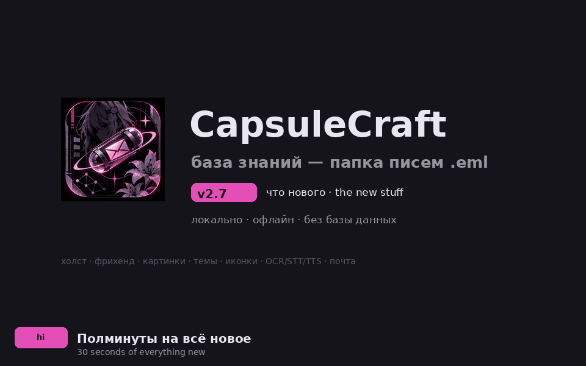

# CapsuleCraft v2.7.0 — Four faces and a working drag · Четыре лица и рабочий драг

## Icon sets: Nova, Document, Capsule — or your own PNG · Иконки

The brand icon is now a **choice**, and it switches **live**: the taskbar icon
follows via `ViewportCommand::Icon` without a restart, the titlebar mark
redraws from the same bytes. **Nova** — a new neon-capsule artwork — is the
default for fresh installs; **Document** is the classic mark; **Capsule** is a
generated minimal pill; **Custom** takes any PNG from the file dialog and
copies it next to `ui_state.json`, so a broken or missing file falls back to
Nova. Entry points: the titlebar mark cycles all four, the command palette
gains four explicit commands. Old configs saved with the retired `mascot`
style deserialize through a hidden alias — nobody's settings get reset.

> Иконка приложения стала **выбором**, и меняется **на лету**: значок в
> таскбаре обновляется без перезапуска, маркер в тайтлбаре перерисовывается из
> тех же байт. **Nova** — новый неоновый арт, дефолт для свежих установок;
> **Document** — классика; **Capsule** — сгенерированная пилюля; **своя** —
> любой PNG из файлового диалога, копируется в данные приложения и умеет
> откатываться на Nova. Входы: клик по маркеру (цикл) и четыре команды палитры.
> Старые конфиги с `mascot` читаются через скрытый алиас — настройки не
> сбрасываются.

## Drag-to-reorder: dead since birth, alive today · Перестановка блоков

The grip-drag announced back in v2.2.1 **never emitted its op**: on the frame
the pointer went up, the stale-state cleanup ran first and wiped the drag
state before the landing check could see it — `pointer.any_down()` is already
false on that frame. The cleanup now runs *after* the drag block, so the
release frame lands the move and only genuinely interrupted drags get dropped.
A regression test drives a real pointer drag through egui's event pipeline
(press → move over block 2 → release) and asserts both the emitted
`Reorder{0, 2}` and the resulting order.

> Драг за грип, объявленный ещё в v2.2.1, **не работал вообще**: в кадр
> отпускания кнопки очистка stale-состояния срабатывала раньше лендинга —
> `pointer.any_down()` в этот кадр уже false, и `BlockDrag` стирался до
> проверки. Очистка переехала *после* драг-блока: кадр отпускания приземляет
> перенос, пропадают только реально прерванные драги. Регрессионный тест
> прогоняет настоящий pointer-drag через событийный пайплайн egui (нажатие →
> перенос над блоком 2 → отпускание) и проверяет и op `Reorder{0, 2}`, и
> итоговый порядок.

## The README finally moves · README ожил

`screenshots/demo.gif` — embedded by the README since forever — **never
existed in the repo**. It is now a 44-frame, 350 KB bilingual reel of
everything across v2.2 → v2.7: themes, onboarding, the canvas, page-as-canvas,
picture nodes, an animated freehand pen, the four real icon styles, the
regression fixes and the shipping matrix. The hero image is Nova, the tests
badge says 272, a Community section links Issues and Releases, and the v2.2.1
row admits the reorder op landed only here.

> `screenshots/demo.gif` — который README подключал с самого начала — **в
> репозитории не существовал**. Теперь это 44-кадровая (350 КБ) двуязычная
> лента всего нового за v2.2 → v2.7: темы, онбординг, холст,
> страницы-как-ноды, картинки, анимированное перо, четыре настоящих бренда,
> фиксы и матрица поставки. Хиро — Nova, бейдж говорит 272 теста, секция
> Community ведёт в Issues и Releases, а строка v2.2.1 честно признаёт, что
> драг доехал только сейчас.

## Tests · Тесты

Icon styles: builtin decode sizes, RGBA bytes, custom fallback (missing
file), custom load from disk, the four-style cycle, the mascot serde alias.
Drag reorder: the event-pipeline regression test above. Native suite:
268 → **272 passed**, 0 failed, 2 ignored.

> Иконки: декод-размеры, RGBA-байты, фолбэк кастома (нет файла), загрузка с
> диска, цикл четырёх стилей, serde-алиас mascot. Драг: регрессионный тест
> выше. Нативный сьют: 268 → **272 passed**, 0 failed, 2 ignored.

## Assets · Файлы

Installer for every platform, OCR engine per OS, one checksum file —
verify with `sha256sum -c SHA256SUMS.txt`.

| Asset | SHA-256 (first 12) |
|---|---|
| `CapsuleCraft_2.7.0_x64-setup.exe` (Windows installer) | `420854a0988b` |
| `CapsuleCraft_native_2.7.0_x64.zip` (Windows portable) | `3415e94445af` |
| `CapsuleCraft_2.7.0_macos_universal.dmg` (arm64 + x64) | `a571d90f02db` |
| `CapsuleCraft_2.7.0_amd64.AppImage` (Linux, zero-dep) | `d6e41663aca1` |
| `CapsuleCraft_2.7.0_amd64.deb` (Linux) | `6b250fefbd83` |
| `mistralrs-engine-windows-x64.tar.gz` (OCR) | `81dc248db27c` |
| `mistralrs-engine-macos-arm64.tar.gz` (OCR) | `52e80f59d38e` |
| `mistralrs-engine-linux-x64.tar.gz` (OCR) | `6daa65455a9e` |

Full digests live in `SHA256SUMS.txt` next to the assets.
Полные суммы — в `SHA256SUMS.txt` рядом с файлами.

## Upgrade · Обновление

Usual paths: the AppImage, the `.deb`, the macOS universal `.dmg`, the Windows
NSIS installer or the portable zip. Capsules and settings stay compatible:
the icon style is one field in `ui_state.json`.

> Обычные пути: AppImage, `.deb`, универсальный `.dmg`, NSIS-установщик или
> portable-zip. Капсулы и настройки совместимы: стиль иконки — одно поле в
> `ui_state.json`.
