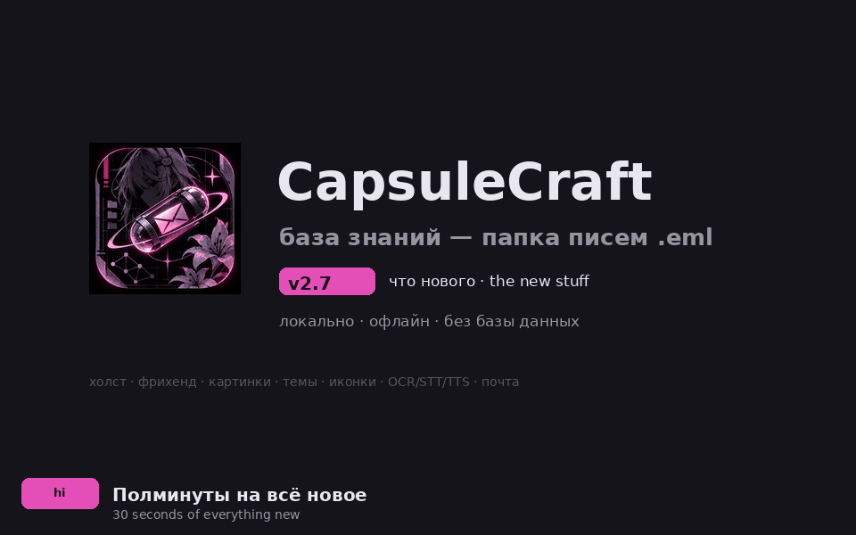

# CapsuleCraft v2.8.0 — Clickable plans, a calendar you can use · Планы кликаются, календарём можно пользоваться

## Every plan is a click away from its page · Каждый план кликается

In the planning view a plan used to respond only to its checkbox, its text
field and its status pill — the row background, the calendar day chips, the
«+N ещё» marker and the Gantt bar were painted-only, so a click landed nowhere
(or silently entered text editing). Now **every plan opens its source page**
when you click it: the row background, a calendar chip, «+N ещё» and the Gantt
bar, all with a pointing-hand cursor. Widgets that live on top of a row keep
winning their own pointer — the background click only fires on genuinely empty
space.

> В планировании план отвечал только чекбоксу, текстовому полю и статус-пилюле:
> фон строки, чипы в днях календаря, маркер «+N ещё» и полоса Ганта были
> «нарисованными» — клик падал в никуда или молча включал правку текста. Теперь
> **каждый план открывает свою страницу по клику**: фон строки, чип календаря,
> «+N ещё» и полоса Ганта — везде курсор-рука. Виджеты поверх строки по-прежнему
> забирают клик себе — фон срабатывает только на действительно пустом месте.

## The calendar is two-pane and drag-aware · Календарь двухпанельный и понимает перетаскивание

The month calendar is now **two-pane**: the grid on the left, and on the right
the focused day with **full task rows** (checkbox, status, due date, capsule
link — the same controls as the agenda) and a **quick add that files the new
task under that day**. Click a day to focus it; click a chip to open the plan;
click «+N ещё» to see all of the day's tasks. The killer move: **drag a chip
onto another day and the plan reschedules** — the hovered day lights up with an
accent outline, the drop patches the due date and a «Срок перенесён» toast
confirms it. A hint line under the month name explains both gestures in your
language.

> Календарь месяца стал **двухпанельным**: слева сетка, справа выбранный день с
> **полными строками задач** (чекбокс, статус, срок, ссылка на страницу — те же
> контролы, что в Повестке) и **быстрое добавление, которое записывает новую
> задачу на этот день**. Клик по дню фокусирует его, клик по чипу открывает
> план, «+N ещё» показывает все задачи дня. Главное: **перетащите чип на другой
> день — план перенесётся**: день под курсором подсвечивается акцентной рамкой,
> дроп правит срок и подтверждается тостом «Срок перенесён». Подсказка под
> названием месяца объясняет оба жеста на вашем языке.

## The Russian README is back · Русский README вернулся

`README.ru.md` was a v1.x fossil — a 135-test badge, the retired mascot hero,
half the feature set missing. It is now a **full mirror of the current
README**: same structure, same screenshots, the complete v1.0 → v2.8.0 release
history. And the language switcher finally works in both directions — the
English README's «Русский» used to point at the English README itself.

> `README.ru.md` был окаменелостью v1.x — бейдж «135 тестов», убранный хиро-маскот,
> половина возможностей отсутствовала. Теперь это **полное зеркало текущего
> README**: та же структура, те же скриншоты, вся история релизов v1.0 → v2.8.0.
> А переключатель языков наконец работает в обе стороны — «Русский» в
> английском README раньше вёл… на английский README.

## A banner and a social card · Баннер и соцкарточка

`screenshots/banner.png` (1600×400) leads both READMEs and
`screenshots/social-card.png` (1280×640) is ready for GitHub Settings →
Social preview: the Nova mark, the bilingual tagline and the feature chips on
the app's own Graphite look.

> `screenshots/banner.png` (1600×400) теперь возглавляет оба README, а
> `screenshots/social-card.png` (1280×640) готов для Settings → Social preview
> на GitHub: маркер Nova, двуязычный теглайн и чипы возможностей в фирменном
> Graphite.

## Tests · Тесты

Five new regression tests drive **real pointer events through egui's
pipeline**: a row-background click opens the page; a calendar chip click opens
the page; a chip dragged onto another day reschedules the plan (due patched,
toast set, drag state cleared); a day click focuses it; kanban and Gantt still
draw headless. Native suite: 272 → **277 passed**, 0 failed, 2 ignored.

> Пять новых регрессионных тестов гоняют **настоящие pointer-события через
> пайплайн egui**: клик по фону строки открывает страницу; клик по чипу
> открывает страницу; чип, брошенный на другой день, переносит план (правится
> срок, прилетает тост, состояние драга чистится); клик по дню фокусирует его;
> канбан и Гантт по-прежнему рисуются headless. Нативный сьют: 272 →
> **277 passed**, 0 failed, 2 ignored.

## Assets · Файлы

Installer for every platform, OCR engine per OS, one checksum file —
verify with `sha256sum -c SHA256SUMS.txt`.

| Asset | Purpose |
|---|---|
| `CapsuleCraft_2.8.0_x64-setup.exe` | Windows installer (NSIS) |
| `CapsuleCraft_native_2.8.0_x64.zip` | Windows portable |
| `CapsuleCraft_2.8.0_macos_universal.dmg` | macOS, arm64 + x64 |
| `CapsuleCraft_2.8.0_amd64.AppImage` | Linux, zero-dep |
| `CapsuleCraft_2.8.0_amd64.deb` | Linux |
| `mistralrs-engine-*.tar.gz` | OCR engine per OS |
| `SHA256SUMS.txt` | full digests |

## Upgrade · Обновление

Usual paths: the AppImage, the `.deb`, the macOS universal `.dmg`, the Windows
NSIS installer or the portable zip. Capsules and settings stay compatible.

> Обычные пути: AppImage, `.deb`, универсальный `.dmg`, NSIS-установщик или
> portable-zip. Капсулы и настройки совместимы.
